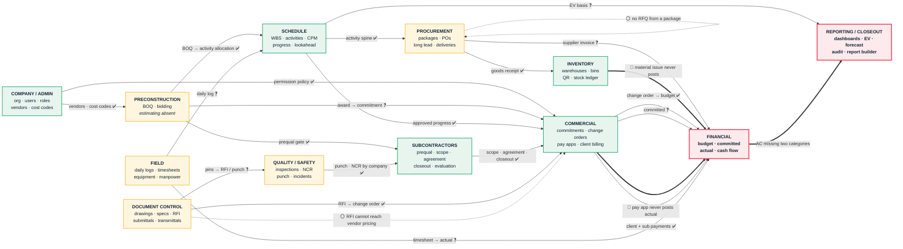
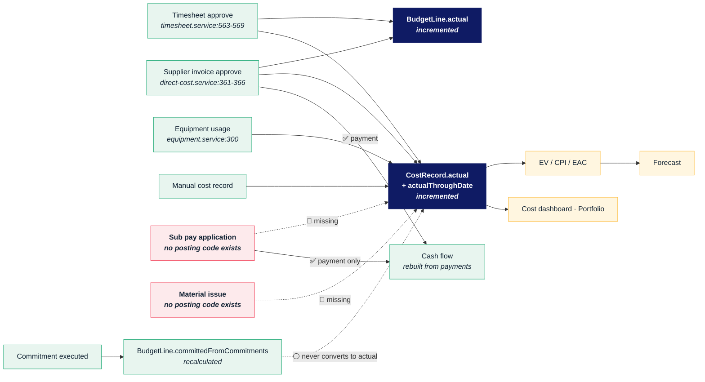
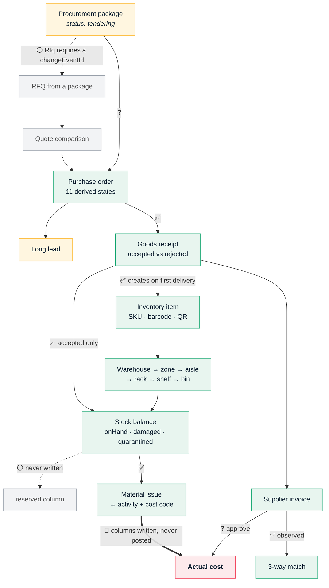
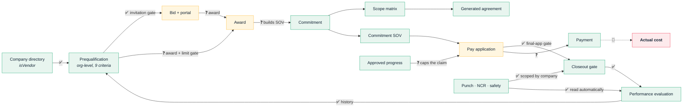
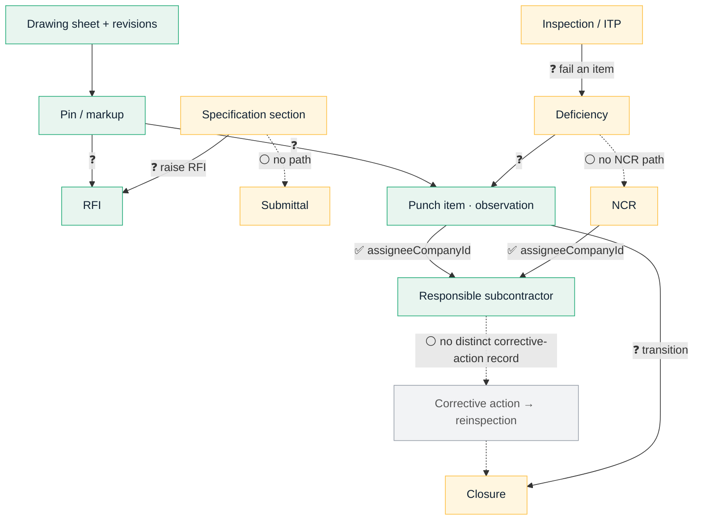
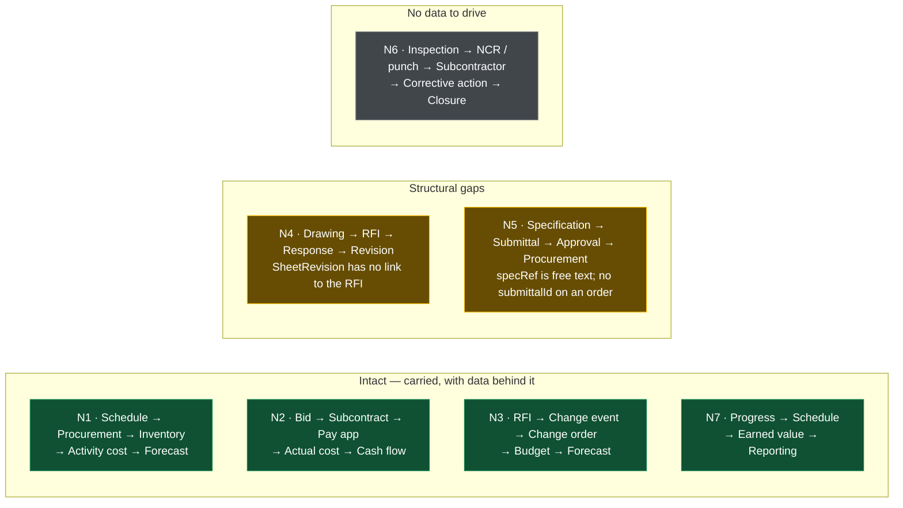
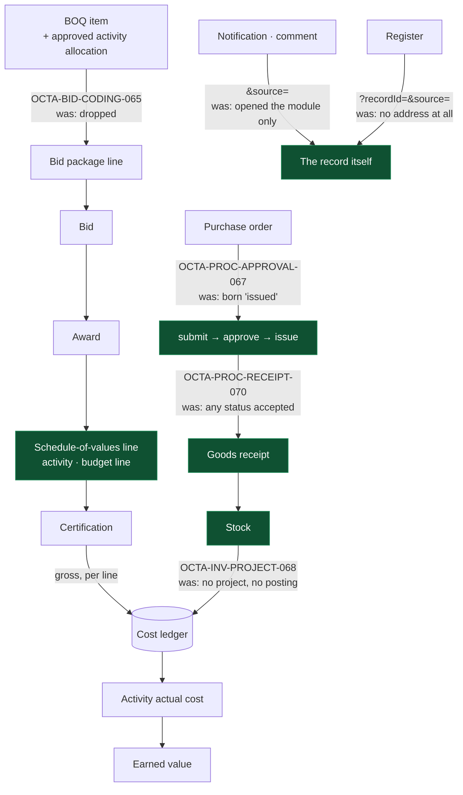

# OctaPM — the system nervous system

> **Audit only.** No feature work was performed. Two temporary inspection
> scripts were written to a scratch directory outside the repository and
> deleted; the QA harness that was executed is the project's own.

---

## 0. Provenance — what was audited

| | |
| --- | --- |
| **Repository root** | `C:/Users/mabde29/OneDrive - Louisiana State University/Constech/octapm-main/octapm-main/.claude/worktrees/procore-competitive-benchmark-6bd1b6` |
| **Main checkout** | `…/octapm-main/octapm-main` (git common dir `…/octapm-main/.git`) |
| **Is a worktree** | **Yes** — a linked worktree of the main repository |
| **Branch** | `feat/p0-foundations-sprint1` |
| **Commit** | `db176510ba76259c5adf71f889f21ec6b6f66c56` |
| **Working tree** | clean |
| **Date of audit** | 2026-09-07 |

### Is this the current OctaPM build?

This mattered enough to test rather than assume. There are four local
branches and no reachable remote (`origin` → `mahmoud63/octapm`, unreachable).

| Branch | Last commit | Notes |
| --- | --- | --- |
| **`feat/p0-foundations-sprint1`** | 2026-09-07 `db17651` | **audited here** |
| `claude/change-sets-0001-0006-20260904-2353` | 2026-09-04 `18b54c7` | checked out in the main worktree |
| `ai-dev` | 2026-06-13 | historic |
| `claude/procore-competitive-benchmark-6bd1b6` | 2026-06-14 | historic |

Both live branches diverged from the same June merge base (`78bdd25`). The
audited branch is **69 commits ahead and 3 commits behind** the change-sets
branch. Those 3 commits are not stale noise — they carry ~7,800 insertions —
so the question is which line is the product.

Tested by marker file:

| Capability | `feat/p0-foundations-sprint1` | `change-sets-0001-0006` |
| --- | --- | --- |
| QA scenario harness (`backend/scripts/qa/run.js`) | ✔ | ✘ |
| Browser E2E (`frontend/e2e/`, `playwright.config.ts`) | ✔ (18 specs) | ✘ |
| Financial spine (`budget`, `commitment`, `sub-pay-app`) | ✔ | ✘ |
| Inventory (`inventory.service.js`) | ✔ | ✘ |
| Prime contract / client billing | ✔ | ✘ |
| Branding (`components/brand/octa-logo.tsx`) | ✔ | ✘ |
| Seed + smoke (`prisma/seed.js`, `scripts/smoke.js`) | ✔ | ✘ |
| Migrations | **104** | 57 |

**Conclusion: the audited branch is the current product line.** Every item the
brief required to be present — QA, browser E2E, financial spine, branding and
navigation — exists here and nowhere else. No switch was made.

> ⚠️ **Recorded as an architectural risk, not actioned.** The change-sets
> branch contains an *unmerged parallel implementation* of contracts, RFI and
> permission templates: `routes/contracts.js`, `features/contracts/index.tsx`
> (1,126 lines), `features/rfi-workflow/index.tsx` (643 lines),
> `features/admin/permission-templates/index.tsx` (533 lines), and a
> `shared/permissions.json` of 1,831 lines against this branch's 1,450. This
> branch has its own `routes/contract.js`, `features/contract/`, and
> `permission-template.service.js`. Two teams solved the same three problems
> twice. Reconciling or formally abandoning that branch is a decision for the
> user — see **AR-1**.

### Environment corrections carried from the failed commands

| Problem | Cause | Correction used throughout |
| --- | --- | --- |
| `backend/src does not exist` | a `Grep` inherited a working directory of `backend/prisma` from a prior `cd` | every search re-anchored to the repository root above, with repo-relative paths |
| `node: command not found` | Node is **not on `PATH` in any shell here**; the Bash tool has no Node at all | PowerShell with `$env:Path = "C:\Program Files\nodejs;" + $env:Path`. Verified: **node v24.19.0**, **npm 11.17.0**, at `C:\Program Files\nodejs\node.exe`. Nothing was installed or upgraded. |

Node **was** available for this pass, so the QA harness below was genuinely
executed. No unexecuted script is presented as evidence anywhere in these
documents.

---

## 1. Evidence rules

Code inspection never produces ✅. Three prior passes each found defects the
1,788-test Jest suite is structurally unable to see — a `NOT NULL` that blocked
every company-level entity, a Prisma `Decimal` walked as a plain object, two
endpoints with no read guard, a missing `createdAt` that 500'd a billing chain.
Mocked Prisma is regression cover, not integration evidence.

| Tier | Evidence | Ran in **this** pass? | Promotes to ✅ |
| --- | --- | --- | --- |
| 1 | **Playwright** — 115 tests in a real browser | at `ee09f5b`; only documentation changed since (verified by `git diff --stat`) → **still current** | yes |
| 2 | **QA scenario harness** — live API, verified in the database | ✅ **re-executed now against `db17651`** — 13 scenarios: 9 pass, 4 partial, 0 fail | yes |
| 3 | **Live API drive** | yes — prequalification, evaluation, cost-posting probes | yes |
| 4 | **Jest** — 1,788 tests, Prisma mocked | not re-run this pass | **no** |
| 5 | **Smoke** — 74 endpoint checks | not re-run this pass | **no** |

The brief required distinguishing three states. They are marked on every row of
the matrix:

- **OBSERVED CURRENTLY** — tier 1–3 evidence against `db17651`
- **PREVIOUSLY VERIFIED** — passed in an earlier pass; code has since changed and it was **not** re-observed → **downgraded to ❓**
- **CODE EXISTS, UNTESTED** — implementation present, no tier 1–3 evidence ever

**Legend:** ✅ verified · 🟡 partial · 🔴 broken · ⚪ missing · ❓ untested

### What the harness observed today (2026-09-07, `db17651`)

```
13 scenarios: 9 pass, 4 partial, 0 fail
```

| Scenario | Result | What it means for this audit |
| --- | --- | --- |
| S-AUTH-001/002, S-PROJ-001 | PASS | auth and project identity current |
| S-TENANT-001/002 | PASS | cross-tenant reads and search refused — isolation holds |
| S-PERM-001 | PASS | every role's RFI permissions enforced |
| S-PERM-002 | PASS | every documented list endpoint refuses the roles its contract excludes |
| S-INT-001 | **PARTIAL** | *"convert-to-change produces a ChangeOrder directly, not a ChangeEvent"* — **GAP-INT-001 confirmed live today** |
| S-INT-002 | PASS | change event → change order, value intact |
| S-INT-003 | **PARTIAL** | submit refused: `CHANGE_ORDER_IMPACT_PROOF_REQUIRED`. The harness could not complete the approval, so **the harness did not verify the budget move today** — it is carried by Playwright instead |
| S-INT-004 | **PARTIAL** | *"the inspection has no items to fail"* — inspection → deficiency still never observed |
| S-INT-005 | **PARTIAL** | `GET /activities` returns a bare array (BUG-API-001 confirmed live); health payload exposes no percent complete, so progress → EV cannot be checked like-for-like |
| S-COMPANY-001 | PASS | company template usable on any project |

---

## 2. Executive diagram — twelve domains



**Read it in three moves.** The spine holds and the left half is sound. Two
thick red nerves enter **FINANCIAL** and never arrive. Everything downstream of
FINANCIAL — earned value, forecast, dashboards, portfolio health — is computed
from an actual cost that is missing those two categories.

---

## 3. Sub-diagram — the money spine



**Two disciplines, mixed.** `committed`, the revised budget and cash flow are
**recalculated** from source rows — they cannot drift. `actual` is
**incremented** at four call sites with compensating decrements on void. The
two missing postings are both in the incremental family, which is precisely why
they were easy to omit: nothing recomputes actual from first principles, so
nothing notices an absent contributor.

---

## 4. Sub-diagram — procurement and inventory



---

## 5. Sub-diagram — the subcontractor lifecycle



The loop closes at both ends: prequalification gates entry, and the evaluation
written at closeout is read back on the next prequalification. The weak middle
is award → commitment → pay app, which has no browser evidence at all.

---

## 6. Sub-diagram — field, quality and document control



Quality records reach the subcontractor correctly and are read automatically
into the closeout gate and the performance evaluation. What is missing is the
middle of the loop: there is no NCR path from an inspection, and no distinct
corrective-action / reinspection record — a punch item simply transitions to
closed.

---

## 7. Inventory — capability assessment

The brief asked whether this is a real inventory system or procurement-material
tracking wearing the name. **It is a real inventory system**, with two defects.

| Capability | Evidence | Status |
| --- | --- | --- |
| Inventory item / material master | `InventoryItem` (sku, category, unit, manufacturer, model, spec, serialised, batched) **and** a separate `MaterialMaster` | ✅ PW-11 |
| Warehouse | `Warehouse` | ✅ PW-11 |
| Storage location | `WarehouseLocation`, self-referencing, materialised `path`, `depth` | ✅ PW-11 |
| Zone / aisle / rack / shelf / bin | one recursive model, `kind` ∈ {zone, aisle, rack, shelf, bin} — full bin path shown on screen | ✅ PW-11 |
| Barcode | `InventoryItem.barcode` (EAN/UPC/Code128) | ✅ PW-11 |
| QR code | `InventoryItem.qrCode`, defaults to the SKU; scanner resolves it | ✅ PW-11 |
| Stock transaction | `StockTransaction`, append-only, signed quantity, `balanceAfter` | ✅ PW-11 |
| Goods receipt | `DeliveryReceipt` + lines; accepted vs rejected split | ✅ PW-11 |
| Material issue | movement type `issue`, to activity + cost code | ✅ PW-11 |
| Stock transfer | `StockTransfer`, `transfer_out`/`transfer_in`, in-transit | ❓ code exists |
| Stock adjustment | movement `adjust` (signed), `count` | ❓ code exists |
| **Reservation** | `StockBalance.reserved` exists and is **read** (`available = onHand − reserved`) but **no code ever writes it**; the issue guard checks `onHand` only | ⚪ **dead column** |
| On-hand quantity | `StockBalance.onHand`, per bin | ✅ PW-11 |
| Available quantity | computed `onHand − reserved` for display — always equals onHand today, and **not** the figure the issue guard enforces | 🟡 |
| Damaged / quarantined | `damaged`, `quarantined` columns with `damage`/`quarantine`/`release` movements | ❓ code exists |
| Inventory valuation | `averageCost` weighted-average, blended on each receipt; `unitCost`, `lastPurchasePrice`; `StockTransaction.value` | ✅ PW-11 |
| **Inventory → cost posting** | **no code path exists** | 🔴 **BROKEN** |
| Inventory → activity | `StockTransaction.activityId` written on issue | ✅ PW-11 |
| Inventory → cost code | `StockTransaction.costCodeId` written | 🟡 written, never consumed |
| PO → inventory receipt | accepted quantity only becomes stock | ✅ PW-11 |
| Invoice → PO → goods-receipt matching | 5 match outcomes, 0.5% price tolerance | ✅ PW-11 |

**Verdict:** a genuine WMS-grade model — recursive bin hierarchy, weighted-average
valuation, append-only ledger, damage and quarantine states, barcode and QR.
Two gaps: reservations are a dead column, and **nothing posts consumption to
cost**, which is the one thing that would make the module financially real.

---

## 8. What a "subcontractor" actually is

There is **no `Subcontractor` model**. The concept is assembled from five
things, which is defensible — but it means no single screen owns it.

| Facet | Where | Scope |
| --- | --- | --- |
| **Company / vendor** | `Company.isVendor`, `type`, trades, `vendorProfileJson` | organisation |
| **Prequalified party** | `VendorPrequalification` (unique per `companyId`) | organisation |
| **Project party** | `ProjectParty` with `partyRole = 'subcontractor'` | project |
| **Portal user** | `CompanyMembership` → `ProjectPartyMember` | project |
| **Commitment party** | `Commitment.vendorCompanyId`, `type = 'subcontract'` | project |
| **Legacy free text** | `SubValuation.subcontractor String` — **required, unlinked** | project |

The modern chain is properly keyed on `companyId` end to end. The legacy
`SubValuation` register still stores the subcontractor as a **free-text
string**, so anything billed through it is invisible to prequalification,
evaluation and closeout.

---

## 9. Three billing systems, correctly separated

The brief asked that these not be collapsed into one vague "invoice". They are
genuinely three distinct chains in the code.

| | **Client / owner (AR)** | **Subcontractor (AP)** | **Supplier (AP)** |
| --- | --- | --- | --- |
| Contract | `PrimeContract` | `Commitment` (`subcontract`) | `ProcurementOrder` |
| Schedule of values | BOQ items | `CommitmentSovLine` | PO lines |
| Claim | `IpcCertificate` + `IpcItem` | `SubPayApp` + `SubPayAppLine` | `DirectCost` + `DirectCostLine` |
| Certification | `certificateFinancials` — gross − retention (capped) − advance recovery − deductions, **then tax** | over-claim + compliance gates, revised-SOV ceiling | 3-way match |
| Payment | `IpcPayment` | `SubPayAppPayment` | `DirectCostPayment` |
| Cash flow | **inflow** ✅ | **outflow** ✅ | **outflow** ✅ |
| **Actual cost** | n/a (revenue) | **🔴 never posted** | ✅ posted |
| Evidence | **PW-12** | PW-16 (gate only) | PW-11 (match only) |

Also present: a **legacy** `SubValuation` register, still read by
`rebuildCashFlow` as an outflow. Two subcontractor payment systems are live at
once — see **D-P0-3**.

---

## 10. Node inventory

**Backend** 106 routes · 124 services · 104 migrations · 37 permission modules ·
720 OpenAPI paths.
**Frontend** 18 workspace modules · 56 feature directories.
**Schema** 62 tables carry `activityId`. The activity-linked spine that
`CLAUDE.md` declares non-negotiable is genuinely honoured, and it is the single
strongest thing about this architecture — it is what makes the missing postings
*fixable* rather than *architectural*.

---

## 11. Priority tables

### P0 — broken nerves

| # | Nerve | Matrix | Effect |
| --- | --- | --- | --- |
| 1 | **Sub pay application → actual cost** | E13, E14 | the largest cost category on most projects never becomes actual |
| 2 | **Material issue → actual cost** | C8, C9 | consumed material never becomes actual; the columns are written and never read |
| 3 | **AC understated → CPI / EAC wrong** | H7, H8 | the metric does not fail, it returns a flattering number |
| 4 | **Forecast inherits it** | G10 | projected final cost is understated by the same two categories |
| 5 | **Two live subcontractor payment systems** | E18 | legacy `SubValuation` posts cash-flow outflows against a free-text name |
| 6 | **`GET /activities` envelope** | K13 | bare array where every peer returns `{items, pagination}` — confirmed live today |

### P1 — missing nerves

| # | Nerve | Matrix | Effect |
| --- | --- | --- | --- |
| 1 | **RFI → change event** | G2 | the commonest origin of a variation cannot reach vendor pricing (**GAP-INT-001**, confirmed live today) |
| 2 | **Procurement package → RFQ → quote** | B2, B3 | no request-to-quote path outside the change-event flow |
| 3 | **Inspection → NCR** | J4 | deficiencies raise punch items or observations only |
| 4 | **Corrective action → reinspection** | J7, J8 | no distinct record; a punch item transitions straight to closed |
| 5 | **Specification → submittal** | I8 | submittal registers typed by hand instead of built from the spec |
| 6 | **Committed → actual conversion** | E6 → H7 | no ledger discipline turns commitment into cost as it is certified |
| 7 | **Stock reservation** | C10 | `reserved` is read but never written, and not enforced |
| 8 | **Revenue ledger** | F7 | client revenue exists only as a cash-flow inflow |
| 9 | **Estimating** | — | no implementation at all |

### High-risk untested nerves

Ranked by *value at risk × absence of evidence*.

| # | Nerve | Matrix | Why it matters |
| --- | --- | --- | --- |
| 1 | **Bid award → commitment + SOV** | A6 | the only path from tender to contract; writes an SOV across four FKs |
| 2 | **Pay-app claim capped by approved progress** | E7 | the control that stops over-billing |
| 3 | **Supplier invoice approve → actual + `actualThroughDate`** | D3 | the one cost chain that works, unverified |
| 4 | **`recomputeCommitted`** | E6 | feeds every committed-cost figure |
| 5 | **Timesheet approve → actual** | *(money trace)* | the other live posting into AC |
| 6 | **Commitment execute → insurance gate** | E5 | a contractual control |
| 7 | **Change event → RFQ → quote → accept** | G4–G6 | the whole vendor-pricing loop |
| 8 | **BOQ allocation → EV basis** | H3 | if allocations are wrong, EV is wrong at the root |
| 9 | **Drawing pin → RFI / punch** | I1, I2 | the field's main capture path |
| 10 | **Inspection → deficiency → punch** | J2, J3 | attempted twice by the harness, never observed |

### Data-model gaps

| # | Gap | Evidence |
| --- | --- | --- |
| 1 | `ProcurementPoLine` has no `costCodeId` / `budgetLineId` | schema |
| 2 | `Rfq.changeEventId` is **required** — RFQ cannot exist outside a change event | schema |
| 3 | `SubValuation.subcontractor` is a required **String**, not a company FK | schema |
| 4 | `StockBalance.reserved` is written by nothing | service scan |
| 5 | No corrective-action / reinspection entity | schema |
| 6 | No revenue ledger; revenue is inferred from `IpcPayment` | service scan |
| 7 | 14 models carry free-text `owner` / `responsible` beside proper FKs | schema scan |
| 8 | `ProcurementOrder.commitmentId` nullable — orders need not reconcile to commitments | schema |
| 9 | Material identity split across `MaterialMaster`, `InventoryItem`, `ActivityMaterial` | schema |
| 10 | No `Subcontractor` entity — assembled from five facets (defensible, but no screen owns it) | schema |

### UX / duplication gaps

See the [duplication audit](./OCTAPM_DATA_DUPLICATION_AUDIT.md) for detail.
P0: two vendor-matching rules · PO lines uncodeable · two payment systems.
P1: vendor identity in eight places · 14 free-text party fields · progress in
four registers · insurance per commitment. P2: "purchase order" means two
records · material identity in three tables. P3: dead reservation column.

---

## 12. Recommended sequence — by dependency, not attractiveness

**Phase 0 — stop reporting numbers that cannot be substantiated** *(blocks everything downstream)*
1. Post sub pay-app certification to `CostRecord.actual` + `BudgetLine.actual` with `actualThroughDate`, mirroring `direct-cost.service:361-366`; reverse on void, exactly as `:401-404` does.
2. Post material issues the same way from `StockTransaction` — the keys are already written.
3. Decide committed → actual: does certification *relieve* committed, or do both stand? Write the rule down before either posting ships.
4. Add a live reconciliation scenario to the QA harness asserting `committed + actual` against source rows. *Without this, 1 and 2 are unverifiable in the same way everything else is.*

**Phase 1 — one-line and small-surface integrity fixes**
5. `ensureVendorCompany` → case-insensitive match (D-P0-1).
6. Add `costCodeId` / `budgetLineId` to `ProcurementPoLine` (D-P0-2).
7. Retire or company-link `SubValuation` (D-P0-3).
8. Normalise the `/activities` envelope (K13, BUG-API-001).

**Phase 2 — close the evidence gap** *(before any new feature)*
9. Playwright: bid → award → commitment → SOV (A6).
10. Playwright: commitment → pay app → approve → payment → **actual** → cash flow (E7–E14) — this also proves Phase 0.
11. Playwright: progress → EV → CPI against known figures, and expose an overall percent complete so the harness can reconcile like-for-like (H4–H8, S-INT-005).
12. Fix the seeded inspection so it has a failable item, then verify J2/J3 — the harness has now been blocked on this twice.

**Phase 3 — missing paths, in dependency order**
13. RFI → change event (G2) — unlocks vendor pricing for the commonest variation origin.
14. RFQ from a procurement package (B2/B3) — depends on 13's pattern.
15. Inspection → NCR, and a corrective-action / reinspection record (J4, J7, J8).
16. Specification → submittal (I8).

**Phase 4 — only now**
17. Estimating · BCF coordination · the 3D IFC viewer · advanced inventory dashboards.

> The brief's example is right: **procurement → PO → goods receipt → inventory →
> supplier invoice must be financially closed before advanced inventory
> dashboards.** A dashboard over an unposted ledger reports confident fiction.

**AR-1 — decision required from the user.** The `claude/change-sets-0001-0006`
branch holds an unmerged parallel implementation of contracts, RFI and
permission templates, including a `shared/permissions.json` 381 lines larger
than this branch's. It should be either reconciled or formally abandoned before
more work lands on top of the divergence. This audit did not touch it.

---

## Companion documents

- [`OCTAPM_MASTER_INTEGRATION_MATRIX.md`](./OCTAPM_MASTER_INTEGRATION_MATRIX.md)
- [`OCTAPM_DATA_DUPLICATION_AUDIT.md`](./OCTAPM_DATA_DUPLICATION_AUDIT.md)
- [`../testing/OCTAPM_INTEGRATION_MAP.md`](../testing/OCTAPM_INTEGRATION_MAP.md) — earlier pass, superseded
- [`../testing/qa-results.json`](../testing/qa-results.json) — **rewritten by this pass**

---

# Addendum — the nerves after Phases 11–15 (2026-09-08)

The body of this document was written at `db17651`, from code inspection plus a
first live pass. What follows is what has since been **driven through the
screens**, and what that changed.

## The seven nerves, as traced



## What was repaired in these phases



## Corrections to the body of this document

| Section | Was recorded as | Actually |
| --- | --- | --- |
| §7 Inventory capability | material issue → actual cost 🔴 | ✅ — posts at weighted average, and now derives the project from the activity |
| §9 Three billing systems | sub-valuations "legacy, still writable" | now **retained read-only**: no new rows, the name immutable, certified and paid rows undeletable (OCTA-FIN-SUBVAL-064) |
| §11 Priority tables | bid → commitment cost coding not assessed | 🔴 **was** losing the activity entirely; now inherits it where unambiguous |

## Two disconnections found in these phases and *not* fixed

- **Two goods-receipt endpoints.** `…/procurement/purchase-orders/{id}/receipts`
  records a delivery and creates **no stock** — it has no `warehouseId` to put
  it anywhere. `/inventory/goods-receipt` creates the stock. Which a user
  reaches depends on which module they opened.
- **No materials RFQ.** `Rfq` is bound to a `changeEventId` — it is a change
  pricing request. Comparing supplier quotes for materials is done by the bid
  module with `commitmentType: purchase_order`, which works but lives under
  Commercial and reads as subcontract bidding.

Both are documented rather than built, per the brief.

---

# Addendum — Phase 18: the BOQ ↔ schedule ↔ cost spine

*2026-09-08. Full write-up: `OCTAPM_BOQ_SCHEDULE_SPINE_CERTIFICATION.md`.*

## The nerve this phase repaired

The bill and the programme were joined by **creation, not reference**. Every BOQ
row typed into the grid minted its own activity, so a project that already had a
schedule ended up with two: the real one holding the logic and the dates, and a
shadow one — zero-duration stubs — holding all the money. Earned value reads
approved allocations, so it would have sat entirely on activities that were on
nobody's critical path.

The join is now an id.

```
BOQ row ──activityId──▶ Activity ◀──activityId── commitment SOV line
   │                       │  ▲                        │
   │                       │  └── ActivityProgress     │
   └── ActivityBoqAllocation (quantity, amount)        │
                           │                           │
                           ├── ActivityCostLoading ────┤  (PV)
                           └── CostLedgerEntry ◀───────┘  (AC)
```

One activity carries planned quantity, planned value, approved progress, earned
value and actual cost. Driven and measured: PV 400,000 · EV 360,000 · AC
200,000 · SPI 0.9 · CPI 1.8, all on `S-100`, with the bill split across three
imported activities and nothing created.

## Corrections to the body of this document

| Section | Was recorded as | Actually |
| --- | --- | --- |
| BOQ → schedule | one row, one activity (documented, deliberate) | still true by default, but a row can now **name** an activity instead of minting one; the shadow schedule was the untested consequence |
| Activity identity | `activityCode` | **two identifiers**, kept apart: `activityCode` is ours, `p6ActivityId` is what an imported activity arrived with. An imported activity has only the second. |
| Schedule revision → money | not assessed | mapped activities are updated **in place** so nothing detaches; unmapped ones are retired, never deleted, and stop earning. Written down in §4 of the certification. |

## A nerve that is deliberately not automatic

`GET /projects/{projectId}/boq/shadow-activities` reports activities that carry
bill value with no duration and no logic, beside a real programme, as
`POTENTIAL_SHADOW_ACTIVITY`. It names same-named activities alongside each one
and **does not merge them**. Deciding two activities are the same piece of work
is a judgement about the job; acting on it automatically would move financial
history on a guess.
