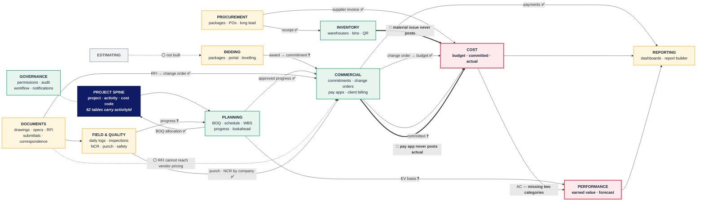
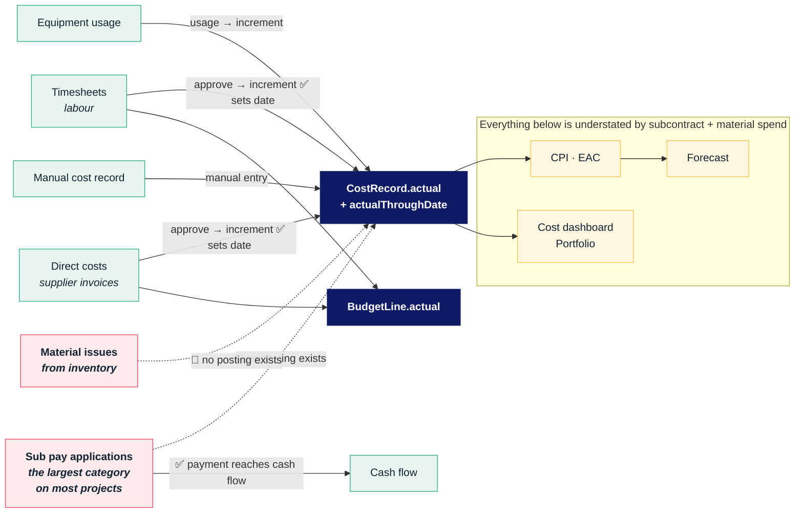
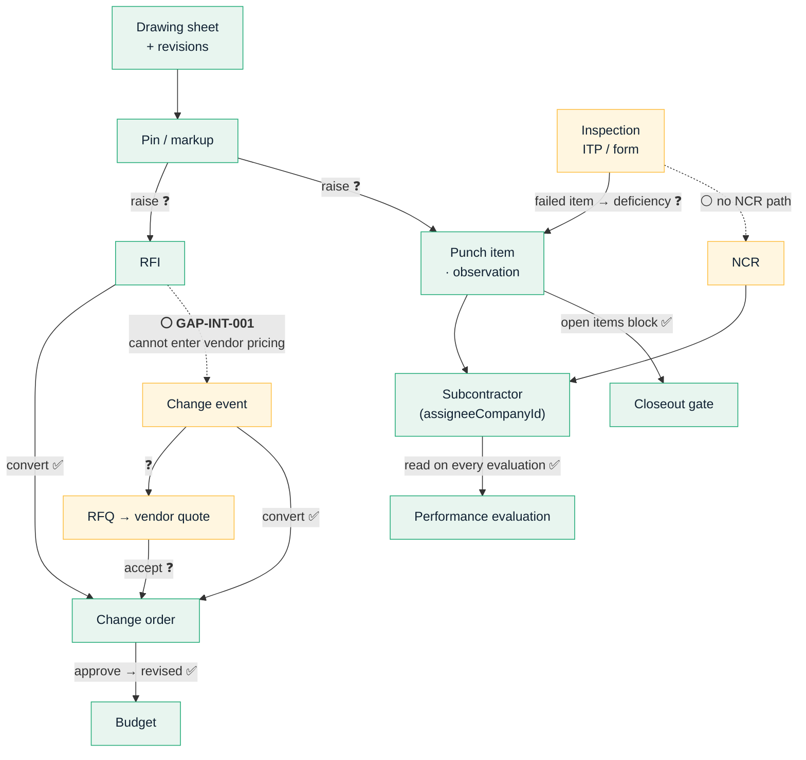

# OctaPM — the system nervous system

**Date:** 2026-09-07 · **Branch:** `feat/p0-foundations-sprint1` · **Head:** `ee09f5b`
**Scope:** inspection only. No feature work was done in this pass.

This document maps how OctaPM is actually wired **today**. Every module is a
node; every posting, foreign key, workflow transition, notification and
generated document is a nerve.

A nerve is only drawn if the current implementation carries it. Nothing is
drawn because it would make business sense.

---

## How a connection earns its status

The user's rule for this audit was explicit: **code inspection alone never
produces ✅**. Four evidence tiers exist in this repository, and only the top
three can promote a connection.

| Tier | Evidence | Promotes to ✅ | Where |
| --- | --- | --- | --- |
| 1 | **Playwright** — driven in a real browser, 115 tests | Yes | `frontend/e2e/*.spec.ts` |
| 2 | **QA scenario harness** — live API, then verified in the database | Yes | `backend/scripts/qa/*.js` |
| 3 | **Live API drive** — endpoints exercised against a running server | Yes | session scripts; findings folded into `docs/testing/` |
| 4 | **Jest** — 1,788 tests, but **Prisma is mocked** | **No** | `backend/src/**/__tests__` |
| 5 | **Smoke** — 74 checks, proves an endpoint answers, not that data crossed | **No** | `backend/scripts/smoke.js` |

Tier 4 is excluded from ✅ on hard evidence, not preference. Three separate
prior passes each found defects that 1,500+ mocked tests were structurally
incapable of seeing: a `NOT NULL` column that blocked every company-level
entity, a Prisma `Decimal` walked as a plain object, two endpoints with no read
guard, a missing `createdAt` that 500'd an entire billing chain, and a
`prisma migrate` reading a BOM. Mocked Prisma cannot see schema, encoding,
constraint or missing-guard defects. It is excellent regression cover and poor
integration evidence.

**Legend**

| | Meaning |
| --- | --- |
| ✅ | Observed working through tier 1–3 evidence |
| 🟡 | Connection exists but the workflow is incomplete |
| 🔴 | Implemented and failing, or implemented in a way that produces a wrong number |
| ⚪ | Required connection does not exist |
| ❓ | Code supports it; no tier 1–3 evidence |

---

## 1. Executive overview — the whole organism

Twelve domains, and the nerves that carry value between them. Detail for every
edge is in the integration matrix; this is the board-level read.

**Read it in three moves.** The spine holds. Two thick red edges enter Cost and
never arrive. Everything to the right of Cost — earned value, forecast,
dashboards — is computed from an actual cost that is missing those two
categories.

---

## 2. The money spine — where the failures are

This is the diagram that matters commercially. Four cost categories should
reach `CostRecord.actual`; **two do not**, and everything that reads actual
cost inherits the error.

**Why this is a single defect with four symptoms.** `earned-value.service`
defines `AC = sum(latest CostRecord.actual by activity where
actualThroughDate <= cutoffDate)`. `timesheet`, `direct-cost`, `equipment` and
`cost` services all write `actual` **and** `actualThroughDate`, so they land in
official AC correctly. `sub-pay-app.service` writes neither — it moves money to
cash flow and stops. `inventory.service` writes neither — `StockTransaction`
carries `activityId`, `costCodeId`, `boqItemId`, `unitCost` and `value`, and
the schema comment above those columns reads *"Where it went, so a cost lands
on the right thing"* — but no service ever reads them into a cost record.

The intent is in the schema. The posting is not in the code.

---

## 3. The field-to-commercial loop

The field-to-quality half of this loop is genuinely closed at the far end:
the closeout gate reads the punch register scoped to the subcontractor's own
company, and the performance evaluation reads NCRs, punch items and safety
incidents by `assigneeCompanyId`. Those are ✅ — both were driven in a browser.

The commercial half has one structural hole. An RFI that turns out to carry
cost converts **straight to a change order**, skipping the change event. Only
a change event can raise RFQs. So an RFI-originated variation can never be
competitively priced by vendors before it becomes a change order — the pricing
step is unreachable from the most common origin of a variation.

---

## 4. Node inventory

**Backend:** 106 route modules · 124 services · 105 migrations · 37 permission
modules · 720 documented OpenAPI paths.
**Frontend:** 18 workspace modules · 56 feature directories.
**Schema:** 62 tables carry `activityId` — the activity-linked spine that
`CLAUDE.md` declares non-negotiable is genuinely honoured, and it is the single
strongest thing about this architecture.

| Core area | Backend | Frontend | Spine link | Status |
| --- | --- | --- | --- | --- |
| Company · Projects · Users · Roles · Permissions | ✔ | ✔ | — | ✅ |
| Cost codes | ✔ | ✔ | `CostCode` → `ProjectCostCode` | ✅ |
| BOQ | ✔ | ✔ | `ActivityBoqAllocation` | ✅ |
| **Estimating** | ✖ | ✖ | — | ⚪ **not built** |
| Bidding | ✔ | ✔ | `BidPackageLine.activityId` | ❓ |
| Schedule · WBS · Activities · CPM | ✔ | ✔ | core | ✅ |
| Progress | ✔ | ✔ | `ActivityProgress` | ✅ |
| Lookahead | ✔ | ✔ | `LookaheadItem.activityId` | ❓ |
| Earned value · Forecast | ✔ | ✔ | reads progress + cost | 🟡 |
| Procurement packages | ✔ | ✔ | `activityId` | 🟡 |
| RFQs | ✔ | ✔ | **change-event only** | 🟡 |
| Suppliers / vendors | ✔ | ✔ | org-level `Company` | ✅ |
| Purchase orders | ✔ | ✔ | `activityId`, `commitmentId` | ✅ |
| Long lead | ✔ | ✔ | `activityId` | ❓ |
| Deliveries · goods receipt | ✔ | ✔ | `DeliveryReceiptLine.activityId` | ✅ |
| Inventory · warehouses · bins · QR | ✔ | ✔ | `StockTransaction.activityId` | ✅ |
| **Material issues → cost** | ✔ | ✔ | columns exist | 🔴 |
| Client contracts | ✔ | ✔ | BOQ is the client SOV | ✅ |
| Subcontracts · commitments | ✔ | ✔ | `CommitmentSovLine.activityId` | ✅ |
| Change events | ✔ | ✔ | `ChangeEventLine.activityId` | ❓ |
| Change orders | ✔ | ✔ | `ChangeOrderActivityLink` | ✅ |
| EOT | ✔ | ✔ | `EotClaimActivityLink` | ❓ |
| Client invoices (IPC) | ✔ | ✔ | `IpcItemProgressLink` | ✅ |
| **Sub pay applications** | ✔ | ✔ | `SubPayAppLine` | 🔴 (cost posting) |
| Supplier invoices | ✔ | ✔ | `DirectCostLine.activityId` | ✅ |
| Payments | ✔ | ✔ | three payment tables | 🟡 |
| Budget · actual cost | ✔ | ✔ | `BudgetLineActivityAllocation` | 🟡 |
| Cash flow | ✔ | ✔ | pulls from payments | 🟡 |
| Documents · drawings · specifications | ✔ | ✔ | `activityId` on drawings | 🟡 |
| RFI · submittals · correspondence · transmittals | ✔ | ✔ | `activityId` on all four | 🟡 |
| Daily logs · equipment · manpower | ✔ | ✔ | `DailyLog*.activityId` | 🟡 |
| Quality · inspections · NCR · punch · safety | ✔ | ✔ | `activityId` on all | 🟡 |
| Meetings · tasks | ✔ | ✔ | `activityId` | ❓ |
| Notifications · audit · workflow | ✔ | ✔ | cross-cutting | ✅ |
| Reporting · dashboards | ✔ | ✔ | 20+ sources | 🟡 |
| Closeout · prequalification · evaluation | ✔ | ✔ | commitment + company | ✅ |

No module is backend-only any more — `GAP-UI-001` (procurement had no UI) was
closed by the procurement module. Estimating is the one core area with no
implementation at all.

---

## 5. What the diagram says at executive level

**The skeleton is sound.** One project spine, one activity spine, one cost-code
master, multi-tenant isolation proven by 8 cross-tenant reads and 1
cross-tenant write all refused, and a permission policy proven by 224 probes
with zero mismatches. Sixty-two tables hang off `activityId`. This is a
coherent system, not a collection of CRUD screens.

**The nervous system has two severed nerves, and they are both in the money
path.** Subcontract payments and material issues never become actual cost.
Every downstream consumer — CPI, EAC, forecast, cost dashboard, portfolio
health — is understated by exactly those two categories, which on a typical
construction project is the majority of spend. The system will report a
flattering CPI on a project that is losing money.

**One nerve is missing where variations are born.** RFIs convert directly to
change orders, and only change events can raise RFQs, so the most common
origin of a variation cannot reach competitive pricing.

**The evidence base is uneven, not thin.** Where a chain has been driven in a
browser it is genuinely closed — client billing, purchase orders, inventory,
scope, agreement, closeout, prequalification, evaluation all have real
end-to-end cover. But the two oldest and most valuable chains — bid → award →
commitment, and commitment → pay app → payment — have never been driven end to
end in any tier-1/2/3 harness. They are carried entirely by mocked tests, which
is the exact evidence class that has already missed five defects on this
codebase.

---

## Companion documents

- [`OCTAPM_MASTER_INTEGRATION_MATRIX.md`](./OCTAPM_MASTER_INTEGRATION_MATRIX.md) — every connection, with trigger, payload, permission, audit, notification and test evidence
- [`OCTAPM_DATA_DUPLICATION_AUDIT.md`](./OCTAPM_DATA_DUPLICATION_AUDIT.md) — where a person retypes what OctaPM already holds
- [`../testing/OCTAPM_INTEGRATION_MAP.md`](../testing/OCTAPM_INTEGRATION_MAP.md) — the earlier pass this supersedes
- [`../testing/OCTAPM_DEFECT_REGISTER.md`](../testing/OCTAPM_DEFECT_REGISTER.md) — open defects
