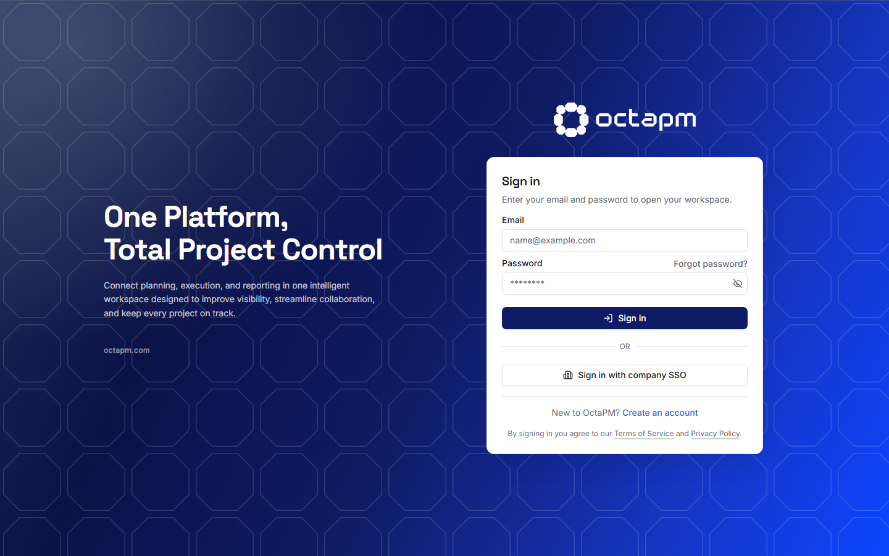
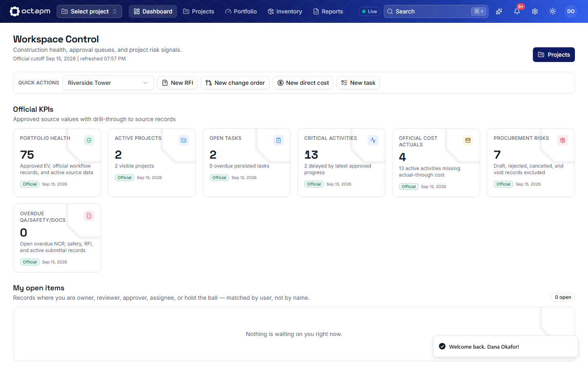
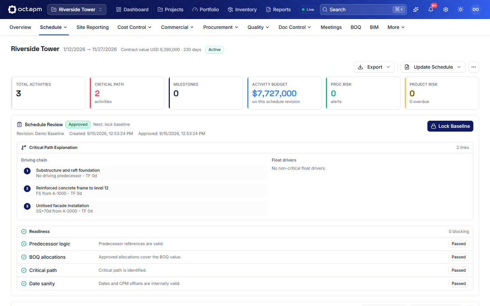
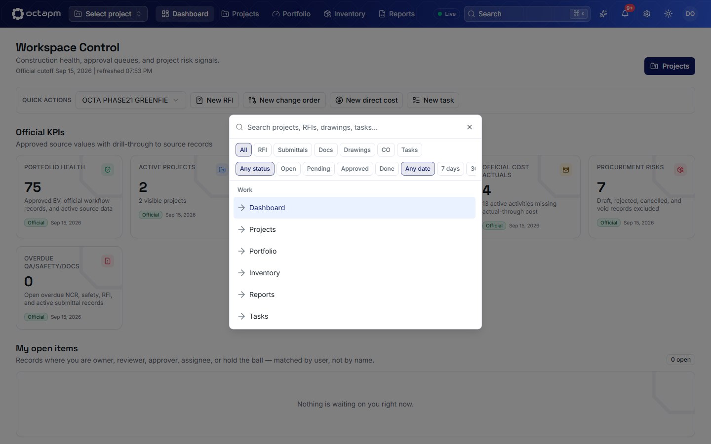
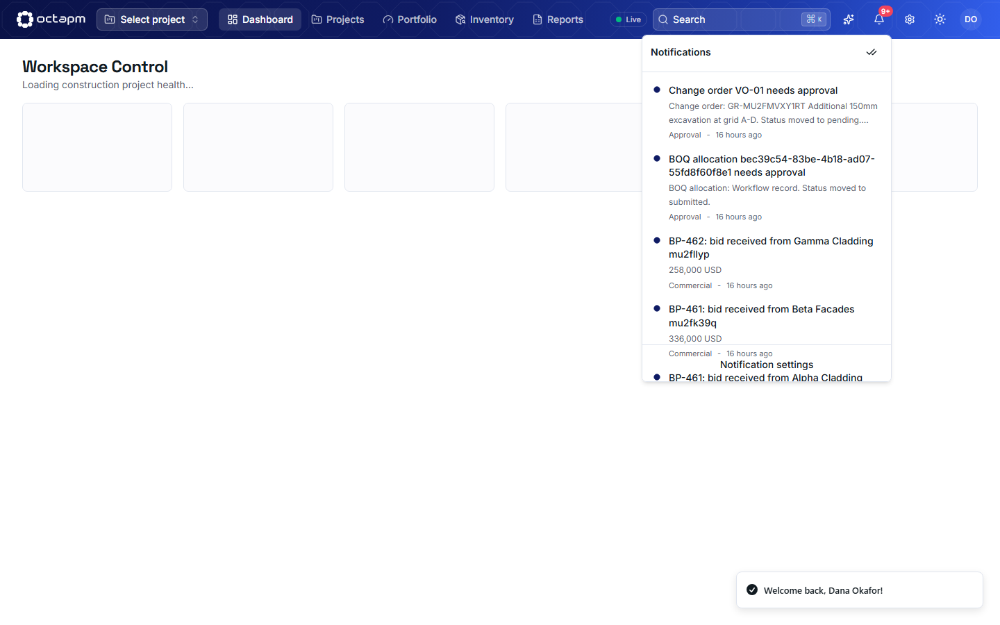

# OctaPM Quick Start

Ten minutes to your first productive session. OctaPM is a single workspace for construction
project controls: schedule, cost, commercial, procurement, stores, documents and quality, all
connected, so a change in one place shows in the others.

## 1. Sign in

Open the OctaPM address your company gave you and enter your work email and password. If your
company uses single sign-on, choose **Sign in with company SSO** instead. Forgot your password? Use
**Forgot password?** under the form.

You land on **Workspace Control**.

## 2. Read your workspace

Workspace Control is your daily start page.

- **Official KPIs** at the top: portfolio health, active projects, open tasks, critical activities,
  cost actuals, procurement risks, overdue quality and document items. They are worked out from
  approved records, with a drill-through to the records behind each figure.
- **My open items** (Needs You): the records waiting on you. If it says "Nothing is waiting on you
  right now", nothing is.
- **Pending review**: values submitted but not yet approved, kept apart from the official figures.
- **Quick actions**: one-click starts for the records your role creates most.

## 3. Select a project

Use **Select project** in the top bar to open a project. Quick actions on Workspace Control have
their own **In project…** control, remembered on this device. The project page shows the header
(name, dates, contract value, status) and the **module bar**: Overview, Schedule, Site Reporting,
Cost Control, Commercial, Procurement, Quality, Doc Control, Meetings, BOQ, BIM and **More**
(Capture, Activities, Equipment, Locations, Photos, Team, Reports).

Modules with sub-tabs open a menu: for example Commercial → Change Orders, Commitments, Pay
Applications, Bids. Every module and sub-tab has its own address, so you can bookmark it and
refresh it.

## 4. Act on Needs You

Open an item from **My open items** and you land on the record with the control you need: Answer,
Approve, Submit closeout, Receive delivery. When you act, the item leaves your list and the next
person's list gains one, without anyone refreshing.

## 5. Use quick actions

From Workspace Control: **New RFI**, **New change order**, **New direct cost**, **New task**. Each
opens the module with its create form already open, for the project chosen in the block's
**In project…** control (remembered on this device). You see only the actions your role can
perform.

## 6. Find anything

Press **Ctrl+K** (or use **Search** in the top bar) to search projects, RFIs, drawings and tasks by
name or number. Inside a project, Doc Control → Search finds text inside documents.

## 7. Notifications

The bell in the top bar lists what changed on records you follow; open one to go to the record.
Under your account menu, **Settings → Notifications** sets which events reach you and how.

## 8. Get help

- Every register shows who holds each record and what they are expected to do; start there.
- **Ask OctaPM** in the top bar answers questions about the project's own data.
- **Help Center** under the account menu; your company administrator for access and roles.
- The full handbook: `OCTAPM_USER_GUIDE.md`, your role guide under `roles/`, and the glossary.

## Your first 15 minutes (any role)

1. Sign in.
2. Read Official KPIs.
3. Open My open items and act on what is yours.
4. Select your project.
5. Open the module you own (your role guide names it).
6. Open one record and read its status and who holds it.
7. Try a quick action, then cancel it.
8. Press Ctrl+K and search for your project.
9. Open the bell in the top bar.
10. Sign out from the account menu when you leave a shared machine.
