# OctaPM User Guide

The master guide to OctaPM as it is today, validated in the browser on 15 September 2026. Role
guides under `roles/` tell each person what is theirs; this guide explains the product.

## 1. Welcome to OctaPM

OctaPM is one workspace for running a construction project: schedule, site reporting, bill of
quantities, cost control, commercial, procurement, stores, documents, quality, meetings and
reports. Every record links to a schedule activity, and every approval moves a figure somewhere
else, so the budget, the forecast and the dashboards say the same thing as the registers. It
replaces the spread of planning tools, spreadsheets and email threads with registers that know
whose move it is.

## 2. OctaPM at a glance

| Area | What it holds |
| --- | --- |
| Workspace Control | your KPIs, what needs you, pending review, quick actions |
| Project Overview | the project's key figures and its setup readiness |
| Schedule | Gantt, activities, progress, lookahead, earned value, forecast, resources, risks, long lead, revisions |
| Site Reporting | daily log, timesheets, activity, site diary, review |
| BOQ | the bill, its upload and its allocation to activities |
| Cost Control | budget register, direct costs, cost by activity and phase, burn rate, equipment |
| Commercial | change orders, change events, commitments, pay applications, bids, client billing, IPC, contract, cash flow, budget revisions, EOT, weather delays |
| Procurement | packages, purchase orders, suppliers |
| Inventory | scan, goods in, match, items, warehouses, dashboard, ledger |
| Quality | NCR, inspections, punch list, observations, safety, material tests |
| Doc Control | RFIs, submittals, drawings, specifications, transmittals, correspondence, emails, search |
| Meetings, Tasks | minutes, actions, tasks |
| Reports | report builder on every register, weekly progress, earned value |
| Company | directory, vendors, cost codes, equipment, templates, workflows, custom fields, integrations, security, permissions |
| People | the organisation's users and roles |

## 3. Signing in

Open the address your company gave you. Enter your work email and password and press **Sign in**,
or use **Sign in with company SSO**. **Forgot password?** starts a reset by email. New people
arrive by invitation: the email's link opens **Accept invite**, which shows the organisation, role,
project and company you were invited to; set a password and you are in.

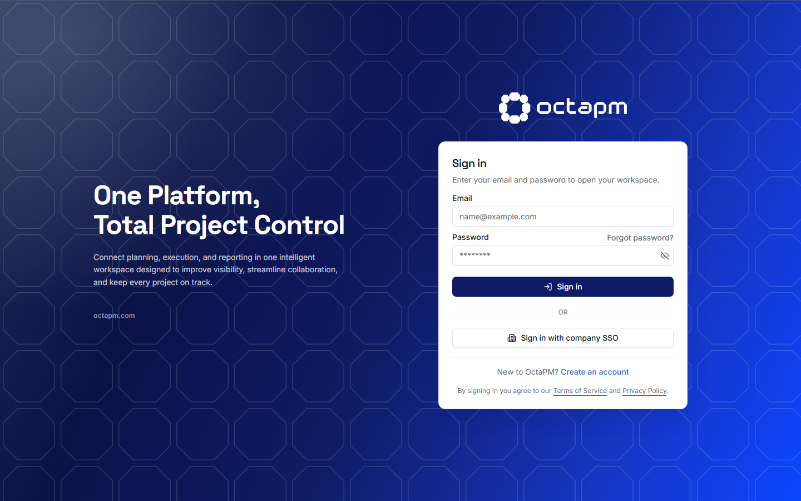

Sign out from the account menu (your initials, top right) → **Sign out** → confirm. A session
that has expired says so and returns you to the sign-in page.

## 4. Workspace Control

Your landing page.

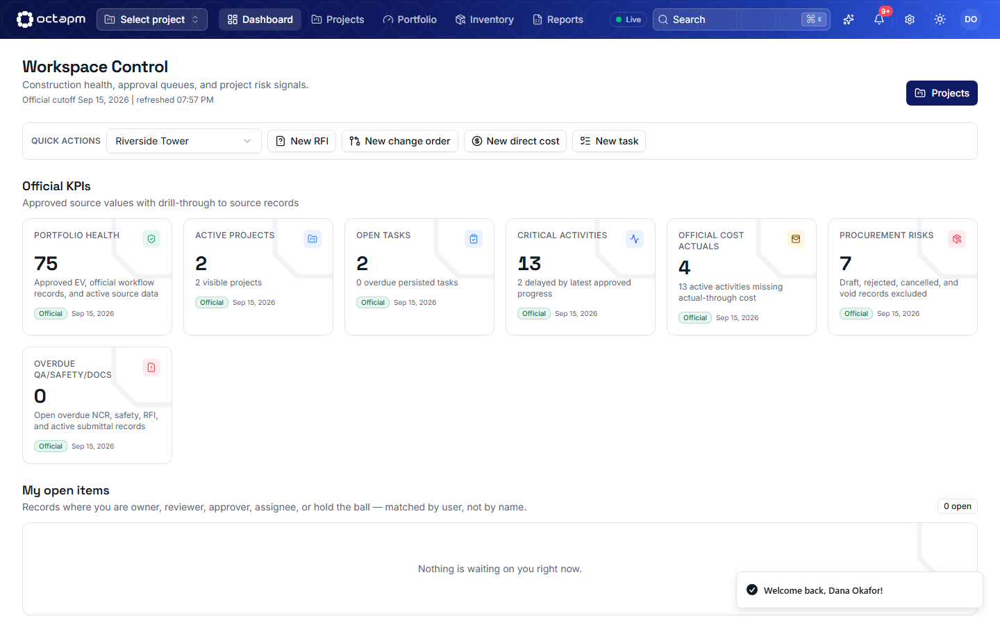

- **Official KPIs**: Portfolio health, Active projects, Open tasks, Critical activities, Official
  cost actuals, Procurement risks, Overdue QA/safety/docs. Each is worked out from approved
  records only and says which records lie behind it. The header shows the official cutoff and
  when the figures were refreshed.
- **My open items** (Needs You): the records where you are owner, reviewer, approver, assignee or
  hold the ball; matched to your account. See chapter 7.
- **Pending review**: values submitted but not yet approved, kept apart from the official figures.
- **Quick actions**: New RFI, New change order, New direct cost, New task, for the roles that can
  raise them. See chapter 8.
- **Workflow queues, health dimensions and watchlist** further down.

## 5. Selecting a project

**Select project** in the top bar lists the projects you may open. Quick actions have their own **In project…** control on Workspace Control, remembered on this device. **Projects** in the top bar lists every project
with dates, status, contract value and, for those allowed, New Project, Edit and Archive.
**Portfolio** shows health, earned value, cash and open items across projects, with an XLSX
export.

A person who is not a member of a project sees "Project access restricted"; the administrator
adds them on the project's Team.

## 6. Understanding navigation

- **Top bar**: Dashboard (Workspace Control), Projects, Portfolio, Inventory, Reports, Tasks,
  Messages, Users (People, administrators only), Company (administrators only), Settings, Help
  Center; Search (Ctrl+K), Ask OctaPM, notifications bell, theme, account menu.
- **Project header**: name, dates, contract value and duration, status, and the module's own
  actions (Export, Update Schedule, More actions).
- **Module bar**: Overview, Schedule, Site Reporting, Cost Control, Commercial, Procurement,
  Quality, Doc Control, Meetings, BOQ, BIM, More (Capture, Activities, Equipment, Locations,
  Photos, Team, Reports). Modules with sub-tabs open a menu. Your role sees only the modules and
  sub-tabs it may read; a bookmarked address to something hidden lands on what is offered.
- **Addresses**: every module and sub-tab has its own address. Refresh keeps you where you are;
  a link to a record opens that record.

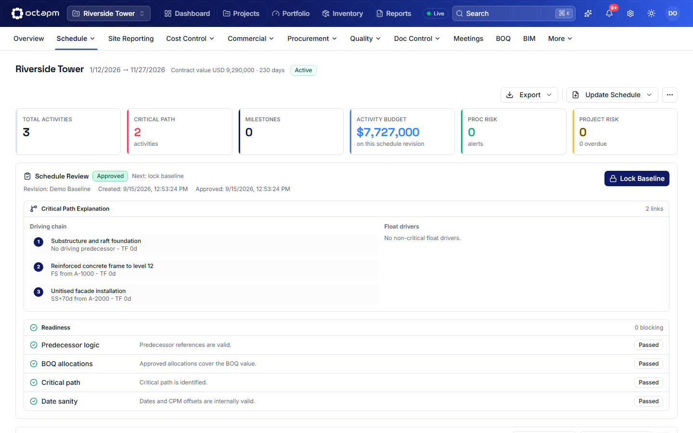


## 7. Needs You

"My open items" on Workspace Control lists what waits on you, with the record's reference,
what is expected, and how long it has waited. It updates without a refresh: when a colleague
submits, your list gains an item; when you act, it leaves. Registers say the same thing per row
("Awaiting the QS — to be sent for approval"). If nothing waits, the block says "Nothing is
waiting on you right now."

The Responsibility Guide explains the words (owner, assignee, approver, ball in court).

## 8. Quick Actions

From Workspace Control, one click opens the module with its create form already open, on the
project chosen in the block's **In project…** control (remembered on this device):

| Quick action | Opens | Who sees it |
| --- | --- | --- |
| New RFI | Doc Control → RFI, New RFI form | PM, Planner, Site Engineer, Quality Engineer |
| New change order | Commercial → Change Orders, Add Change Order | PM, QS |
| New direct cost | Cost Control → Direct Costs, new direct cost | PM, QS, Cost Controller |
| New task | Tasks, new task | PM, Planner, Site Engineer, Quality Engineer |

Procurement, Storekeeper and Finance see no quick actions; their work starts from the module
bar.


## 9. Notifications

The bell in the top bar lists what changed on records you follow (an approval waiting, a status
moved) with **Mark all read**. Preferences are under Settings → Notifications: the "due soon"
window, and push notifications on this device where the company has set them up. There is no
separate notifications page in this release; the bell is the list.

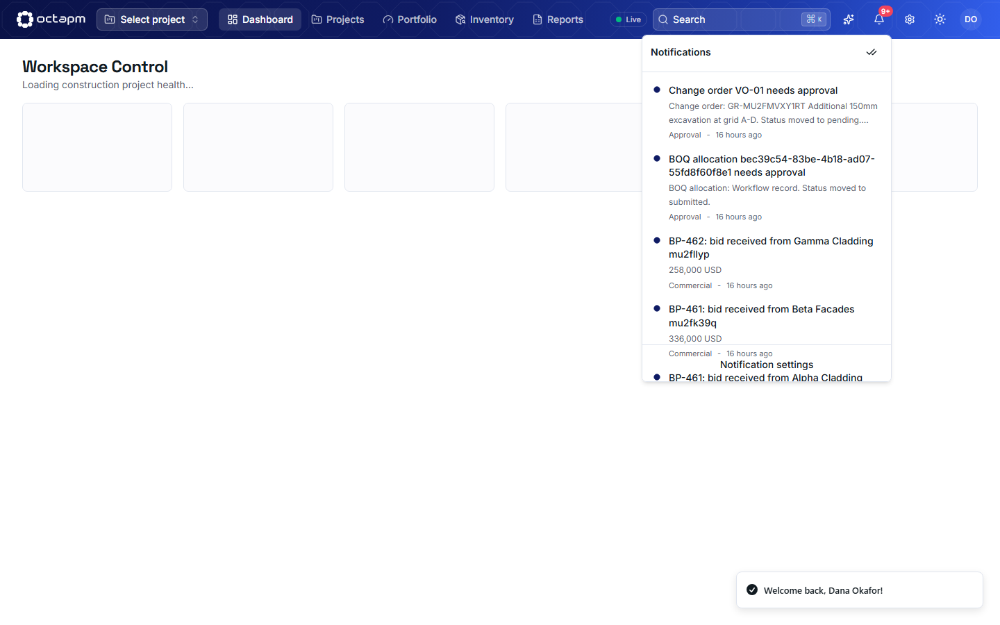

## 10. Search

**Search** in the top bar (or Ctrl+K) opens the command menu: type to find projects, RFIs,
drawings and tasks by name or number, and jump to them. Inside a project, Doc Control → Search
looks inside PDF, Word, Excel and PowerPoint files: quotes for exact phrases, OR between
alternatives, a leading minus to exclude a word. The Reports page's **Ask for a report** turns a
sentence into a saved report.

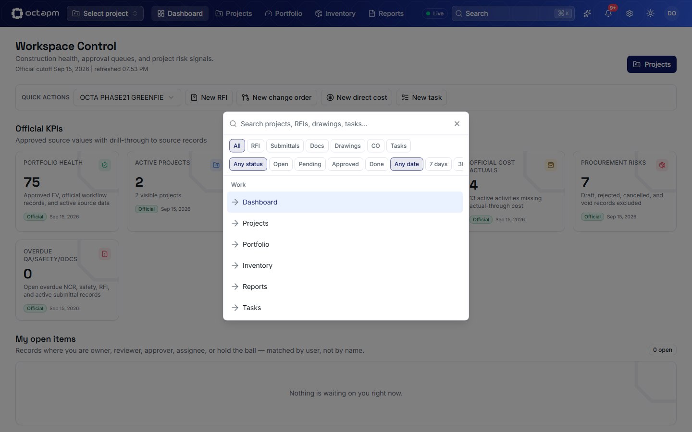

## 11. User roles

| Role | In one line |
| --- | --- |
| Company / Admin | keeps people, companies, cost codes, templates and permissions; creates projects (the PM account holds this) |
| Project Manager | runs the project; approves changes, orders, commitments, pay applications, progress, RFIs |
| Planner | owns the schedule, progress approval, lookahead, long lead |
| QS / Commercial | bill, budget lines, change orders, pay applications, valuations, bids |
| Cost Controller | budget position, direct costs, timesheet approval |
| Procurement | packages, purchase orders, suppliers, bid publishing |
| Storekeeper / Warehouse | receipts, stock, issues, stores |
| Site Engineer | progress, daily log, RFIs, NCRs, punch, inspections, timesheets |
| Quality Engineer | NCR and safety approval, inspections, punch closure |
| Finance | payments, invoices, receipts, retention, matching, period lock |
| Supplier / Bidder | prices a package through the invitation link; no login |

The Role Feature Matrix gives every feature per role, from the product's permission policy.

**Client / Owner: NOT SUPPORTED as a login.** The project holds the client's contract, valuations,
invoices and receipts, and an owner company can be named as a party, but a representative
invited today receives an internal role and the contractor's navigation; there is no owner
view. **Subcontractor: NOT SUPPORTED as a login**, for the same reason; subcontract records,
pay applications and evaluations are kept by the contractor's team on the subcontractor's
behalf. Both are outside this release's pilot.

## 12. Project setup

Overview shows the project's key figures (total activities, critical path, milestones, activity
budget, procurement and project risk) and a **setup readiness** checklist for a new project:
schedule (import a Primavera P6 XER, P6 XML or MS Project XML file, or generate a schedule from the
bill), BOQ, budget lines, team, parties. The checklist collapses once done. Project templates
(Company → Project templates) start a project with a ready structure.

## 13. Project team

Project → More → **Team** lists everyone with access, their role on this project, their company,
their permissions and the source of their access. **Add existing user** searches the organisation
by name or email and adds the person with a role for this project; somebody without an account is
invited by email from People. Permission templates (Company → Permissions) narrow or widen a
role on one project.

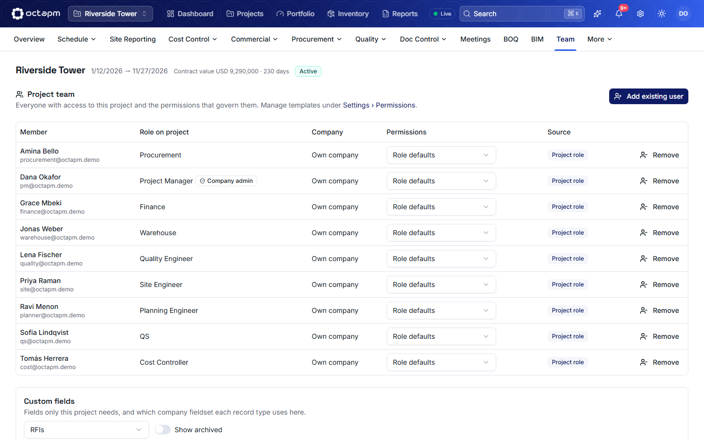

## 14. Schedule

Sub-tabs: **Gantt** (default, with the baseline, the critical path explanation, driving chain and
float drivers), **Activities**, **Progress**, **Lookahead**, **Earned Value**, **Forecast**,
**Resources**, **Risks**, **Long Lead**, **Revisions**, **WBS**. Header actions: **Update Schedule**,
**Lock Baseline**, **Export**.

- The planner edits activities and logic, submits a revision for the PM's review; the PM
  activates it and locks the baseline.
- Site progress is submitted on Progress (or Capture) and approved by the planner or PM;
  approved progress drives earned value (EV, SPI, CPI), activity status and the critical path.
- Long Lead lists materials with need dates and order-by dates; late-to-order items are the
  workspace's procurement risks.
- Risks are submitted by the planner, QS or PM and approved by the PM.


## 15. Site reporting

Tabs: **Daily Log**, **Timesheets**, **Activity**, **Diary**, **Review**, with a day strip,
**Today**, **Open**, **Manpower report** and **Settings**. The daily log records manpower,
equipment, deliveries, visitors, delays and notes, with a report draft built from the day's
records (a dictation option and, where the company has set it up, an AI-assisted draft). Site
engineers, planners and quality engineers update and submit; the PM approves; distribution sends
the log. Timesheets hold crews and workers; the cost controller or PM approves them and labour
cost posts.

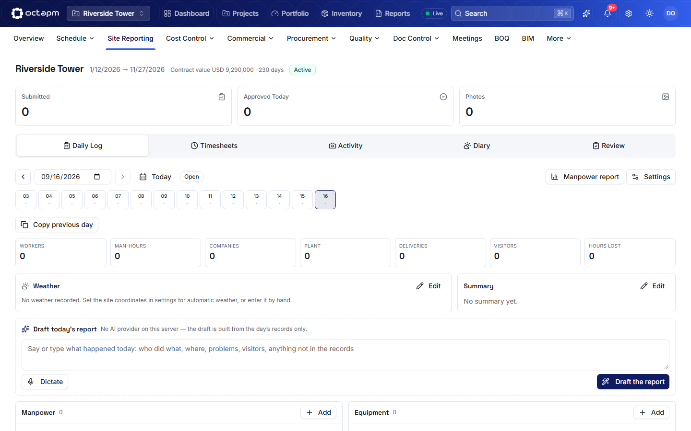

## 16. BOQ

BOQ Management: upload the bill as a spreadsheet (compared against the current bill), draft
activity suggestions, allocate items to activities, approve allocations (QS or PM), and hold the
official value used by earned value and IPC. The Budget tab notes when the budget does not equal
the bill.

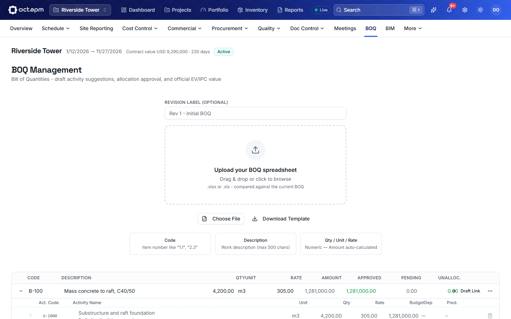

## 17. Cost Control

Sub-tabs: **Overview**, **By Activity**, **By Phase**, **Equipment**, **Burn Rate**, **Budget**,
**Direct Costs**.

Overview's budget block reads as the budget register states it: Original budget, Approved
changes, Revisions & transfers, Revised budget; then Allocated to activities, Executed
commitments (value of executed subcontracts and purchase orders), Actual cost (posted to the
Actual Cost Ledger to date), Forecast (EAC, never below actual), and optimistic, most-likely and
pessimistic estimates at completion.

The Budget tab lists lines by cost code and type with Original, Changes, Revised, Executed
commitments, Actual, Forecast, Variance and Allocated; **Cost codes** adopts the company's codes;
**Add line** creates a line. Actual cannot be typed on a line. Direct Costs records costs paid
directly, approved by the PM or Finance.

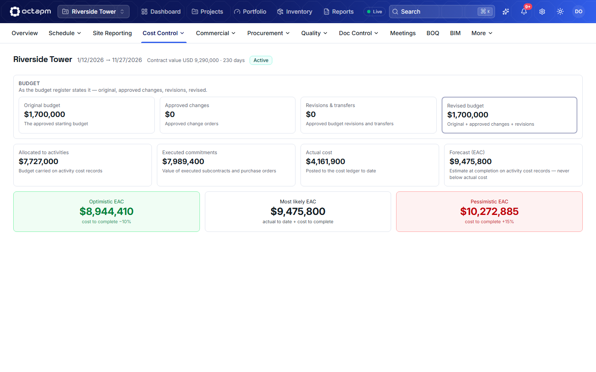
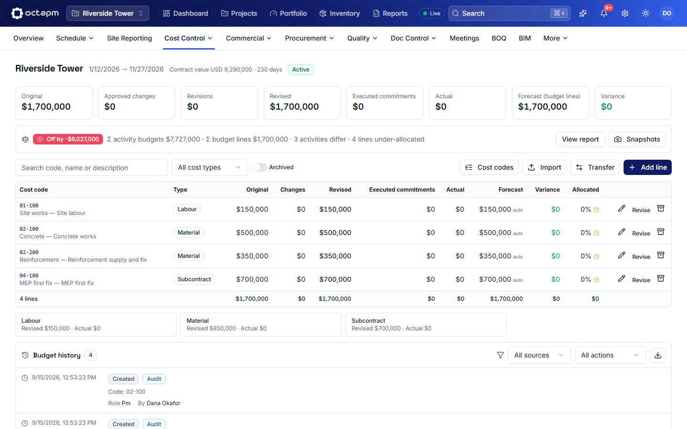

## 18. Commercial

Sub-tabs: **Client Billing**, **Change Events**, **Change Orders**, **Commitments**, **Pay
Applications**, **Bids**, **IPC**, **Sub Valuations (legacy)**, **Budget Revisions**, **Cash
Flow**, **EOT**, **Weather Delays**, **Contract**. Your role sees the tabs it may read.

- **Change Orders**: the register with Approved VOs and pending totals, the approval queue, and
  **Add Change Order** (description, category, value, schedule and cost impact, affected
  activities, budget line or split, supporting documents from the register or from files
  already on another record). Submit → PM approves.
- **Change Events**: potential changes with scope and rough order of magnitude, RFQs to vendors,
  quotes accepted, converted to change orders once priced.
- **Commitments**: subcontracts and purchase-order commitments with original and approved
  changes, schedule of values, scope matrix, closeout checklist, evaluation.
- **Pay Applications**: subcontractor claims per period with retention, deductions, materials on
  site; review (QS), approve (PM), pay (Finance), accounting export.
- **Bids**: packages, lines, invitations, publish, questions, leveling, award.
- **Client Billing, IPC, Contract, Cash Flow**: the client contract set up once (form of
  contract, notice periods, clauses, notice monitor), periods certified and invoiced, receipts,
  retention, inflow and outflow.
- **Budget Revisions, EOT, Weather Delays**: additions and deductions to the budget; extension of
  time claims with delay, critical-path impact and proof; weather delay allowance.

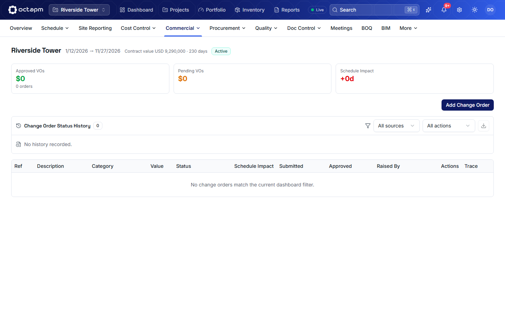
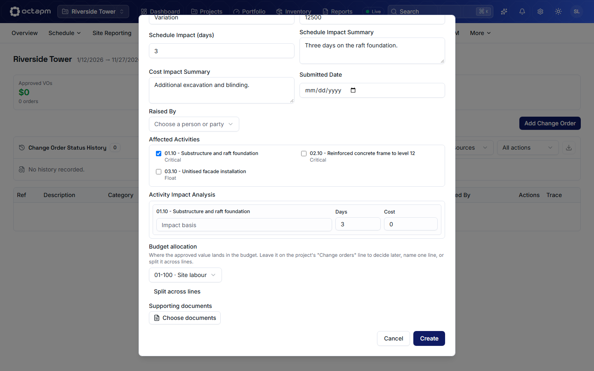

## 19. Procurement

Sub-tabs: **Packages**, **Purchase Orders**, **Suppliers**. A package is a thing the project needs
bought, with the date it is needed on site and its lead time; it is created from a material
requirement on the schedule. Purchase orders move draft → approval (PM) → issued → acknowledged →
delivered → invoiced → closed, and each row says who holds it; **Receive delivery** opens Goods
in with the order found. KPIs: orders, PO value, invoiced, waiting on you.

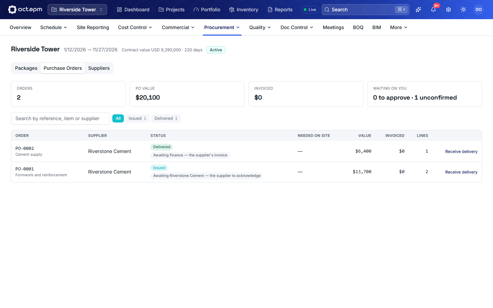

## 20. Inventory

Workspace → **Inventory** (company-wide): Stock value, Items, Below reorder, Out of stock, Issued
recently; tabs **Scan**, **Goods in**, **Match**, **Items** (with inline Issue), **Warehouses**
(zones, aisles, racks, shelves, bins), **Dashboard**, **Ledger**. A receipt puts stock on the shelf
and marks the order delivered; an issue takes stock out for an activity and posts its cost.

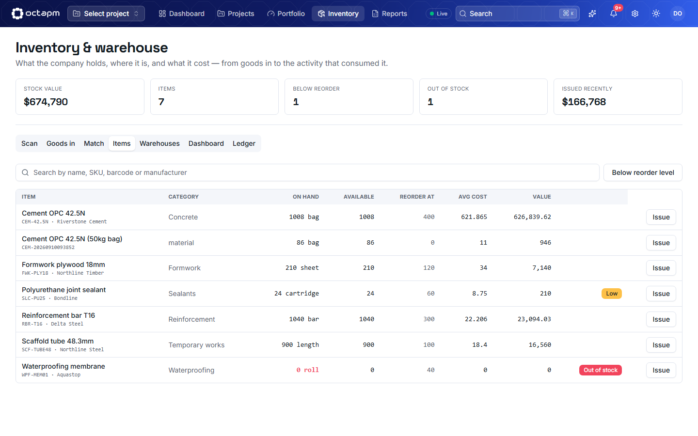
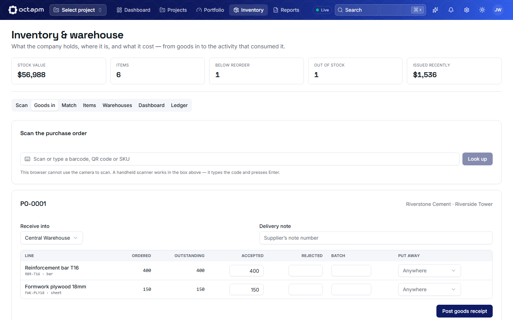

## 21. Document control

Sub-tabs: **RFI**, **Submittals** (Register, Packages, Workflows), **Drawings** (sheets and sets
by discipline and area, current sheets, offline list), **Specifications**, **Transmittals**,
**Correspondence**, **Emails** (inbound), **Search** (inside documents). KPIs: Open RFI, Overdue
RFI, Pending Submittal, Pending Ack, Notices, Due Alerts. RFIs: quick-add box, **New RFI** form,
Details with Reply and Close, saved filters, "Waiting on me", audit history.

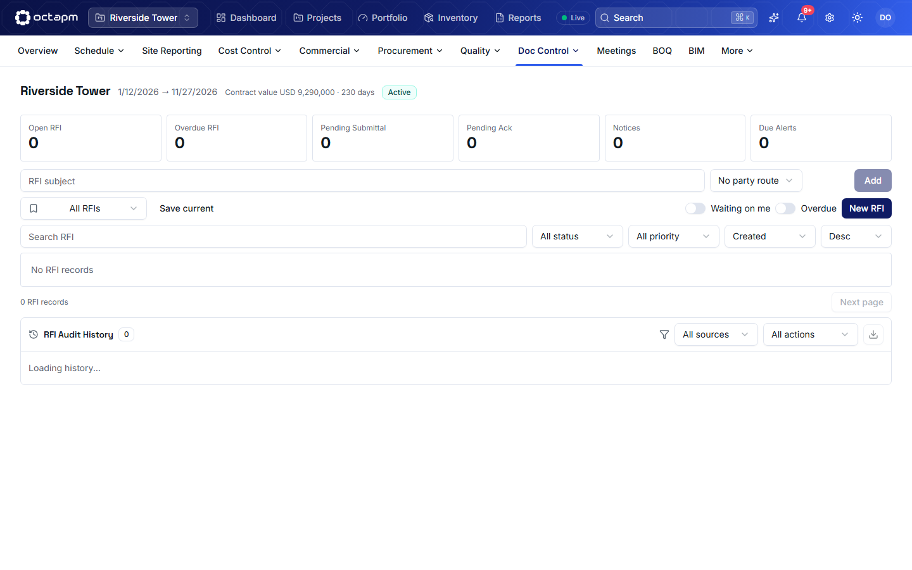
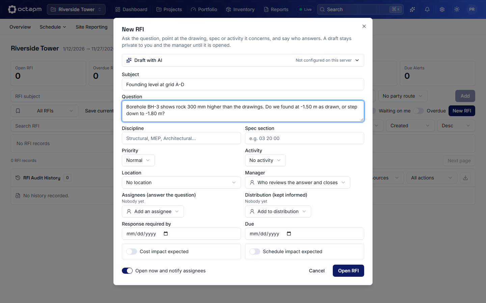
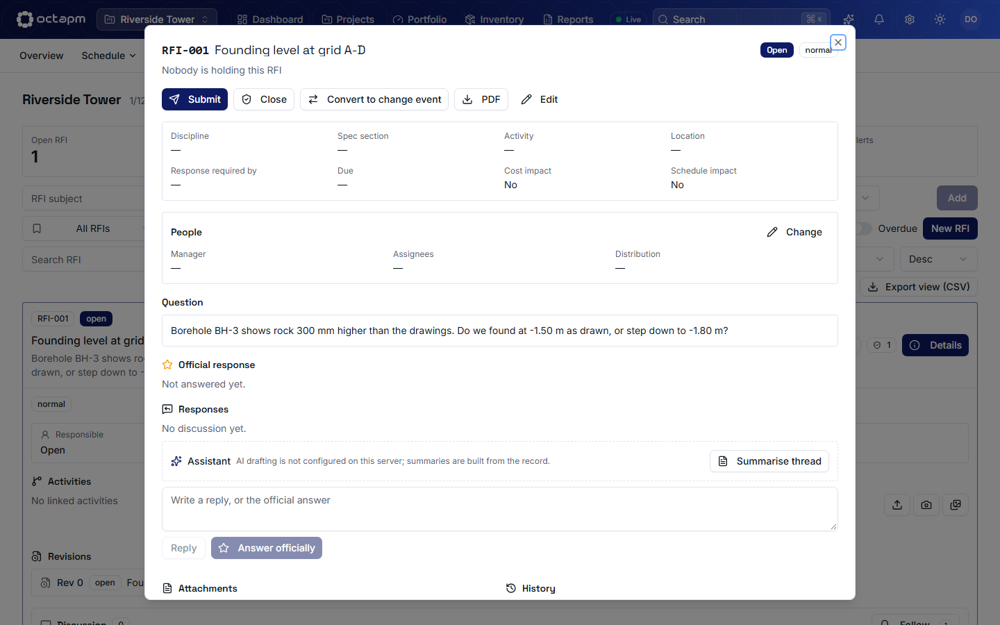

## 22. Quality

Sub-tabs: **NCR**, **Inspections** (from templates, with hold points), **Punch list**,
**Observations**, **Safety**, **Material Tests**. Dashboard KPIs: Quality Score, Major NCR, Failed
ITP, Open punch items, Safety open, Observations, Due alerts. **New NCR…**, **Record incident…**
and **Log test…** open one dialog with severity, activity, responsible person and company, due
date. The responsible person submits the closeout with evidence; the quality engineer approves.

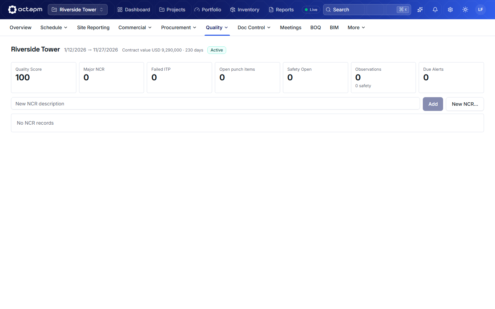
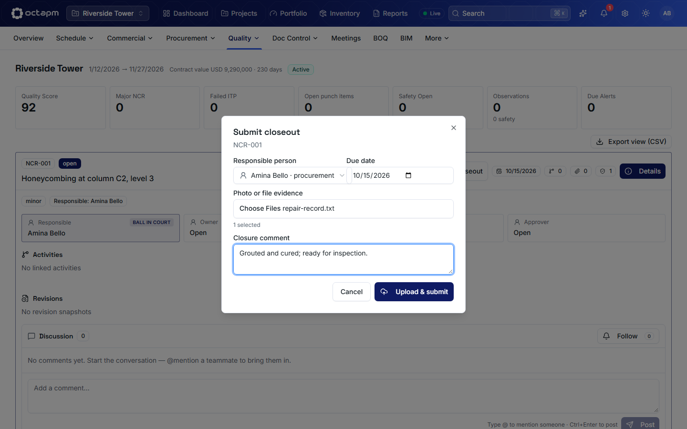

## 23. Meetings & tasks

**Meetings**: the minutes register (draft, distributed), attendees, agenda, open actions;
**New**; distribution by the PM or planner. **Tasks** (top bar, and the New task quick action):
project actions with assignee, due date, status and priority, comments and closeout; export of
the view.

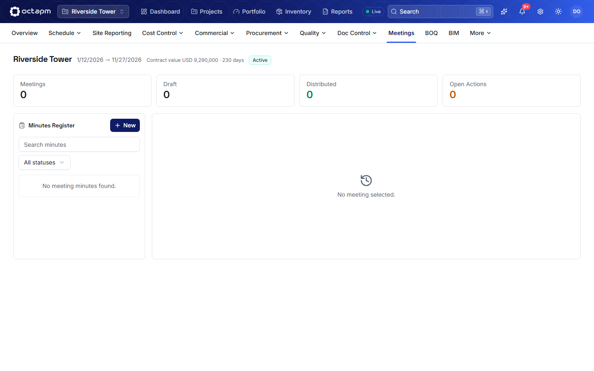

## 24. Reports

**Reports** (top bar): build a report on any register (activities, RFIs, submittals, punch,
observations, inspections, NCRs, safety, change orders, commitments, pay applications, tasks,
risks, purchase orders, long-lead items, payment certificates, activity cost, budget lines, daily
log manpower, direct costs, timesheet entries, BIM elements, lookahead items, daily logs) with
columns, filters, grouping and a chart; export it, share it, or deliver it on a schedule. **Ask
for a report** fills the builder from a sentence. Project → More → **Reports**: the Weekly Progress
report (planned, actual, variance, manpower, weather, submit) and the Earned Value report
(S-curve, top activities by budget).

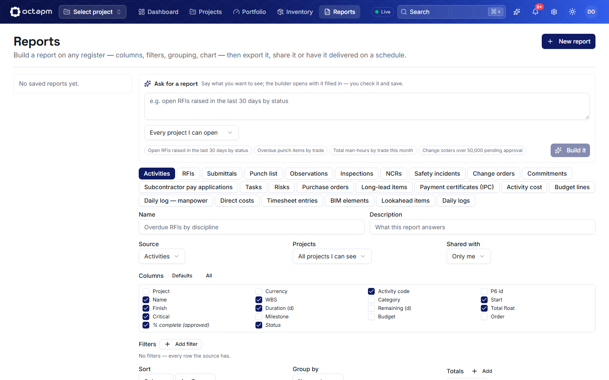

## 25. Settings and administration

**Settings** (account menu): Profile, Account, Security (password, MFA), Appearance, Notifications,
Display, Billing, Permissions. **Company** (administrators): Directory, Vendors, Cost codes,
Equipment, Project templates, Inspection templates, Submittal workflows, Workflows (approval
routes that apply on every project), Custom fields, Integrations (API keys, webhooks, accounting),
Security, Permissions (templates assigned per project from Team). **People**: everyone in the
organisation, their role and projects; Invite by email; Add person. The Admin guide explains
each registry and which is authoritative.

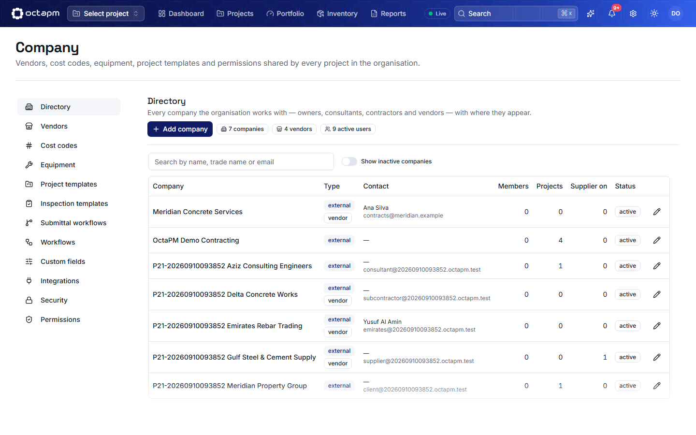

## 26. Connected workflows

```
Schedule activity ──► BOQ allocation ──► Budget line
        │                                     ▲
        ▼                                     │
RFI ──► answer ──► Change order ──► approval ──┘ (Revised Budget, Forecast)

Material requirement ──► Package ──► Purchase order ──► Goods receipt ──► Stock ──► Issue ──► Actual Cost
RFQ / bid package ──► bids ──► award ──► Commitment ──► Pay application ──► certification ──► Actual Cost ──► payment ──► Cash Out
Timesheet ──► approval ──► Actual Cost
Direct cost ──► approval ──► Actual Cost
Client valuation (IPC) ──► certification ──► invoice ──► receipt ──► Cash In
Inspection ──► NCR ──► corrective action ──► approval ──► Quality Score
Meeting ──► actions ──► tasks ──► closeout
```

The Workflow Guide walks every chain: who starts, what they do, who receives, what changes,
who approves, the final state. What happens next, for the most common actions:

- **You approve a change order**: Revised Budget rises; the named budget line's Changes column
  carries the value; Forecast follows; the register shows Approved with you as approver; the
  audit history records it; the QS sees it within a second; commercial reports update.
- **You post a goods receipt**: the order reads Delivered; stock, average cost and value rise in
  the store; the buyer's list updates without a refresh; the match is ready for the invoice.
- **You issue material**: stock falls; the Actual Cost Ledger gains an entry against the
  activity; Actual Cost and Forecast rise.
- **You certify a pay application**: certified gross posts to Actual Cost; retention is held;
  Finance receives it for payment.
- **You pay**: Cash Out rises; Actual Cost does not change.
- **You approve progress**: earned value, SPI, CPI, activity status and the critical path update;
  the workspace KPIs move.
- **You approve an NCR closeout**: the NCR closes, leaves the responsible person's Needs You, and
  Quality Score recovers.

## 27. Frequently asked questions

**Why is Actual cost not what I typed?** It cannot be typed. It is the sum of posted entries:
certifications, material issues, direct costs, approved timesheets.

**Why does the Approve button not appear?** The record is not submitted, lacks proof, or your
role does not approve it. The row says who holds it.

**Why does Commercial open on Change Events for me?** Your role may read only that tab.

**Where is the notifications page?** The bell in the top bar; preferences under Settings.

**A change order was approved but the line shows nothing.** It named no line and sits on the
"Change orders" holding line; the register row says "Budget line: …".

**Can a client or subcontractor log in?** Not in this release (chapter 11). Suppliers price
packages through the invitation link.

**Can I undo an approval?** Change orders, RFIs, NCRs and punch items can be reopened by the
roles that approve them; payments and certifications are reversed by Finance's own records.

## 28. Troubleshooting

| Symptom | What to do |
| --- | --- |
| "Project access restricted" | Ask the administrator to add you on the project's Team. |
| "Session expired" | Sign in again; your work up to the last save is kept. |
| A page shows "Page Not Found" | The address is not one the product offers (for example /notifications); use the top bar. |
| A module is missing from the bar | Your role does not read it; the Role Feature Matrix says who does. |
| A figure differs between two screens | Refresh once; if it persists, note both screens and the time and tell your administrator. |
| The supplier's link expired | Resend the invitation from the bid package. |
| An order cannot be received | It must be issued or acknowledged; draft, planned and cancelled orders are refused. |
| Search inside documents finds nothing | The index may need a rebuild (Doc Control → Search → Rebuild) by an administrator. |
| "No AI provider on this server" on the daily log | The draft is built from the day's records; the report still works. |

## 29. Terminology / glossary

See `OCTAPM_GLOSSARY.md`.

## 30. Support / escalation

1. The record's row says who holds it and what is expected; the audit history says what
   happened.
2. **Ask OctaPM** in the top bar answers questions about the project's data.
3. **Help Center** under the account menu.
4. Your company administrator for access, roles, companies and cost codes.
5. For a product problem, note the screen, the record reference, the time and what you expected;
   the administrator raises it with OctaPM support.
