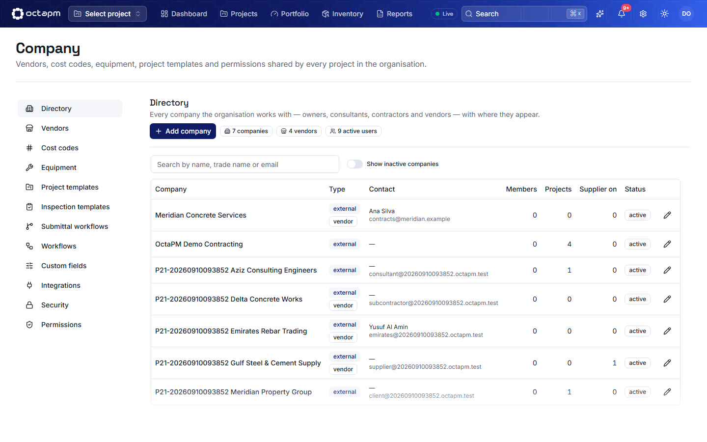

# Company / Admin

Validated in the browser on 15 September 2026 as Dana Okafor (company administrator; the Project
Manager account holds company administration in this release). The people workflows (adding a
person, pending invitations, password-reset e-mail, lost mailbox) were rewritten on 5 October 2026
for the invitation-only change (CERT-3, D-ID-1) and are not yet re-validated in the browser.

## A. Role overview

You keep the company's master data and its people so that every project picks from one set of
truths: companies and vendors, cost codes, equipment, inspection and submittal templates,
workflows, custom fields, integrations, security, permission templates, and the people and their
roles. You create projects and set their teams. Enter once, use everywhere: a company added to
the Directory is the same company on every bid, commitment and invoice; a cost code added once is
the code every budget line, timesheet and direct cost uses.

## B. Your typical day

Requests to add a person, a company or a cost code; a project to create; a role to change; a
template to update. Then the same Workspace Control every PM reads.

## C. Your workspace

Workspace Control as for the Project Manager. Company administration lives under **Company** in
the top bar (Directory, Vendors, Cost codes, Equipment, Project templates, Inspection templates,
Submittal workflows, Workflows, Custom fields, Integrations, Security, Permissions) and under
**People** (the organisation's users). Both links appear only for administrators.

## D. Modules you can access

| Registry or page | Access |
| --- | --- |
| Company → Directory (every company the organisation works with) | FULL ACCESS: add, edit, activate or deactivate; show inactive |
| Company → Vendors (vendor profile, trades, prequalification) | FULL ACCESS |
| Company → Cost codes (code, name, category; import) | FULL ACCESS: add, edit, archive |
| Company → Equipment | FULL ACCESS |
| Company → Project templates, Inspection templates, Submittal workflows, Workflows, Custom fields | FULL ACCESS |
| Company → Integrations (API keys), Security | FULL ACCESS |
| Company → Permissions (permission templates) | FULL ACCESS |
| People (users, roles, invitations, deactivation) | FULL ACCESS |
| Project → Team (members, party members, per-project role and template) | FULL ACCESS |
| Workers and crews | Site Reporting → Timesheets on the project (worker admin) |
| Materials (items) and warehouses | Inventory → Items and Warehouses (item and warehouse management) |
| Locations | Project → More → Locations |
| Everything a Project Manager can access | FULL ACCESS |

## E. Features available to you

Add and edit companies (name, trade name, type, contact, active flag) with a duplicate-name
refusal; vendor profiles and prequalification; cost-code import and edit; project creation from a
template; invitations by email with the role chosen from the policy's roles (including Quality
Engineer) — the only way to add a person; pending invitations (revoke, resend); adding an existing
colleague to a project by name; per-project permission templates; sending a person the
password-reset e-mail; activation and deactivation; API keys for integrations; security settings
(MFA, SSO).

## F. Your core workflows

**Add a company (enter once)**
1. Company → Directory → **Add company**.
2. Name, trade name, type (External, Owner / client, Consultant, Contractor, Subcontractor,
   Supplier), email, phone, website, address; leave **Active** on. **Add company**.
3. What happens next: the company is offered on every project's parties, bid invitations,
   commitments and supplier invoices. A second company with the same name is refused.

**Edit or retire a company**
1. Directory → the pencil on the row → change the fields or switch **Active** off → **Save
   changes**. An inactive company keeps its history and is no longer offered on new records; the
   list hides inactive companies unless **Show inactive companies** is on.

**Add a cost code**
1. Company → Cost codes → **Add cost code** (or **Import** a list).
2. Code, name, category (labour, material, equipment, subcontract, indirect, overhead,
   contingency, other). Save. Edit with the pencil; archive when no longer used.
3. What happens next: projects adopt the code on Cost Control → Budget (**Cost codes** → tick →
   **Apply**), and it is offered on budget lines, direct costs, timesheets and change events.

**Add a person (always an invitation)**
1. People → **Invite** → the person's email. Inviting is the only way to add someone: you never
   create an account or choose a password for anyone. The person sets their own name and password
   from the email's link, or, if they already use OctaPM elsewhere, signs in with their own account
   and accepts.
2. Choose the role: Project Manager, Planning Engineer, QS, Cost Controller, Procurement, Warehouse,
   Site Engineer, Quality Engineer, Finance. Optionally the project and, for an outside company's
   representative, the party (see chapter 11 of the User Guide on what that person receives), and a
   note for the email.
3. What happens next: the invitation is listed under **Pending invitations** until it is accepted.
   The person appears on People only after they accept; then they sign in and land on Workspace
   Control. The link works once and expires after 7 days.
4. If the email could not be sent, People says so and the invitation stays pending: fix the
   address or wait, then **Resend** it from Pending invitations.
5. Someone who is already a member, or who is suspended here, cannot be invited ("already a
   member"). To put an existing member on a project use Team (below); to bring a suspended person
   back use **Activate**.

**Pending invitations**
1. People → **Pending invitations** lists every invitation not yet accepted and not expired, with
   the role, project, note, expiry and whether its last email failed.
2. **Revoke** stops the link at once (an invitation already accepted cannot be revoked).
3. **Resend** sends a fresh link for the same offer (role, project, company, party and note as
   originally sent); the earlier link stops working. To change the offer, revoke it and invite again.
4. Inviting the same email again also replaces the earlier link: only the newest email works.

**A person cannot sign in (forgotten password)**
1. The person uses **Forgot password?** on the sign-in page; that is the normal way back.
2. If they ask you, People → the person → **Send password-reset e-mail**. OctaPM sends its ordinary
   reset email to the address on their account. You never see the link and never set the password,
   and the screen always says the email was sent, whatever the state of the account. The action is
   limited in how often it can be repeated.
3. When the person completes the reset, every session they had open (web, mobile, other
   workspaces) is signed out and they sign in again with the new password.

**Deactivate and bring back a person**
1. People → the person → **Deactivate**. Their access to this workspace stops at once, their
   project assignments here are removed, and any invitation of yours still pending for them stops
   working.
2. To bring them back use **Activate**. An invitation link does not bring back a suspended person.
3. Project assignments are not restored by Activate; put them back on their projects from Team.

**A person has lost access to their email**
OctaPM cannot move an account to a new address, and no administrator can change a person's sign-in
email. If the person still knows their password they keep signing in as before. If they cannot
sign in and cannot receive email at the old address:
1. Invite them at their new email address. This creates a **new** account with only the role you
   choose; it has none of the old account's administration or ownership and none of its project
   assignments.
2. When they have accepted, put the new account on its projects (Team) and, if appropriate, ask a
   workspace owner to grant administration or ownership again.
3. **Deactivate** the old account so nobody can use it.
History recorded under the old account stays under the old name.

**The only owner has lost both email and password**
Nobody in the workspace can recover this from People. Contact OctaPM support: support verifies who
is asking outside the product and can then make another active member of the workspace its owner
(support procedure: `docs/operations/OWNER_RECOVERY_RUNBOOK.md`). To avoid needing this, keep at
least two owners.

**Put a person on a project**
1. Project → More → Team → **Add existing user** → search by name or email → pick → set the role
   for this project (defaults to their company role) → **Add**.
2. A permission template can narrow or widen what they do on this project (Team → the person →
   permissions; templates under Company → Permissions).

**Create a project**
1. Workspace → Projects → new project (name, dates, currency, contract value, client), or from a
   project template.
2. Overview → the setup readiness checklist: activities (import a P6 or MS Project file or
   generate a schedule), BOQ, budget, team, parties.

## G. Your approvals

As Project Manager (see that guide). As administrator: activation and deactivation of accounts,
role assignment, party assignment and removal, workflow and custom-field management, email
settings.

## H. Handoffs

A company you add is picked by the QS, procurement and finance; a cost code by cost control,
site (timesheets) and the QS; a person you invite lands on Workspace Control with their role's
quick actions and Needs You.

## I. Reports you use

People (role and projects per person); Directory counts (companies, vendors, active users);
Company → Security; Integrations (API keys and their scopes).

## J. Common mistakes

- Creating a company twice under slightly different names; the Directory refuses an exact
  duplicate but not a variant. Search before adding.
- Inviting a person with the wrong role; before acceptance revoke the invitation and invite again,
  after acceptance change it on People, and set the project role on Team.
- Re-inviting a suspended person to bring them back; it is refused. Use **Activate**.
- Inviting a person at a new address because they forgot their password; that makes a second
  account. Ask them to use **Forgot password?**, or send them the password-reset e-mail.
- Archiving a cost code that budget lines still use; the lines keep it, but new records cannot
  pick it.

## K. Troubleshooting

- **A person says a module is missing.** People → their role; Project → Team → their project role
  and template.
- **A vendor cannot be invited to a bid.** It is not prequalified: complete prequalification under
  Vendors, or let the PM record an override reason on the invitation.
- **A company does not appear in a picker.** It is inactive; switch **Show inactive companies** on
  and re-activate it.
- **A person says the invitation link does not work.** Only the newest invitation email works, and
  only once and for 7 days. Check Pending invitations; **Resend** if it is still there, otherwise
  invite again.
- **"Already a member" when inviting.** The person is active here (use Team to add them to a
  project) or suspended here (use **Activate**).
- **A person was signed out everywhere.** They (or you, through the reset email) changed their
  password, or their account was closed or their second factor reset; they sign in again.
- **An integration stopped working (401 "API key is invalid or revoked").** The person who
  created its API key changed their password, had their second factor reset, or had their account
  closed. Those events revoke every key the person created, so a stolen session cannot leave a
  working key behind. Keys other people created are not affected. Create a new key under Company →
  Integrations and give it to the integration. With **Show revoked** on, the old key is listed as
  revoked.
- **Inviting or activating answers that membership changes are paused.** The deployment's
  emergency switch is on; removing access still works. Contact OctaPM support.

## L. Quick reference

| I want to | Go to |
| --- | --- |
| Add or edit a company | Company → Directory |
| Manage a vendor's profile | Company → Vendors |
| Add or edit a cost code | Company → Cost codes |
| Invite a person | People → Invite |
| Revoke or resend an invitation | People → Pending invitations |
| Help a person who forgot their password | People → the person → Send password-reset e-mail |
| Bring back a deactivated person | People → the person → Activate |
| Put a person on a project | Project → More → Team |
| Change what a role may do on a project | Company → Permissions, then Team |
| Create an API key | Company → Integrations |

## M. Daily checklist

- [ ] Invitations pending acceptance (People → Pending invitations; resend any whose email failed).
- [ ] Requests for new companies, vendors, cost codes.
- [ ] People joining or leaving projects.
- [ ] Vendors awaiting prequalification.
- [ ] Then the Project Manager's checklist.

## Your first 15 minutes

1. Sign in. 2. Open Company → Directory and read the active companies. 3. Open Cost codes.
4. Open People and check every person has the right role. 5. Open a project's Team.
6. Open Company → Permissions to see the templates. 7. Open Security. 8. Return to Workspace
Control and read Needs You.

## Which registries are authoritative

| Data | Authoritative place | Used by |
| --- | --- | --- |
| Companies, vendors, contacts | Company → Directory / Vendors | parties, bids, commitments, invoices, NCR responsible company |
| Cost codes | Company → Cost codes | budget lines, direct costs, timesheets, change events |
| People and roles | People; Project → Team for the project role | everything |
| Materials (items) | Inventory → Items | goods receipts, issues, purchase orders |
| Warehouses and bins | Inventory → Warehouses | receipts, issues, transfers |
| Locations | Project → More → Locations | punch items, inspections, photos |
| Workers and crews | Site Reporting → Timesheets | timesheets |
| Equipment | Company → Equipment; Project → Equipment | cost by equipment |
| Templates | Company → Project / Inspection templates, Submittal workflows, Workflows | new projects, inspections, submittals, approvals |

Limitations in this release: the company registries have search and filters but no page-level
audit view or pagination; the Directory shows every active company in one list.
