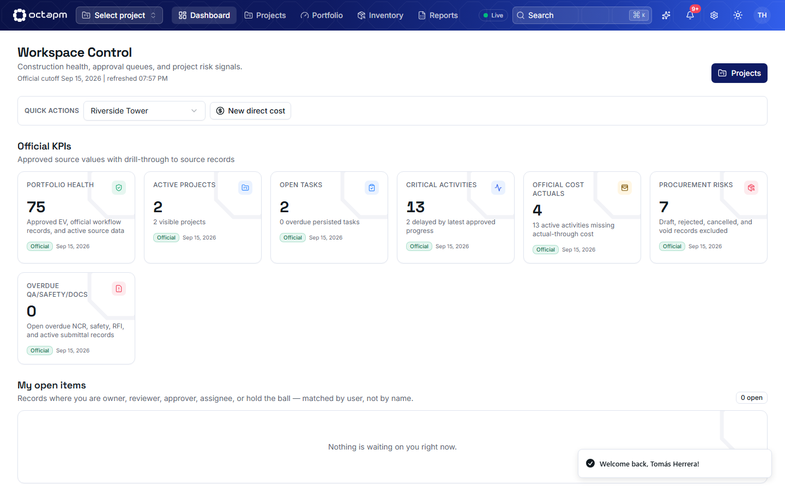

# Cost Controller

Validated in the browser on 15 September 2026 as Tomás Herrera (Cost Controller).

## A. Role overview

You watch the money against the plan: budget lines, executed commitments, actual cost, forecast
and variance, by line, activity and phase. You record direct costs, keep activity cost figures
and burn rates, and approve timesheets so labour cost is right. You do not raise variations or
certify subcontractors; you read what the QS and the PM decide and report on it.

## B. Your typical day

Workspace Control → Official cost actuals, Pending review, My open items (timesheets to approve).
Then Cost Control → Overview: Original, Approved changes, Revised, Executed commitments, Actual,
Forecast, Variance, and the lines behind them.

## C. Your workspace

Needs You: timesheets to approve, direct costs sent back, tasks. Quick actions: **New direct
cost**. KPIs: official cost actuals ("active activities missing actual-through cost") and pending
review.

## D. Modules you can access

| Module | Access |
| --- | --- |
| Cost Control (Overview, By Activity, By Phase, Equipment, Burn Rate, Budget, Direct Costs) | ACTION ACCESS: budget lines, direct costs (create, submit), activity cost, burn rate; approval and payment of direct costs are the PM's or Finance's |
| Site Reporting → Timesheets | APPROVE: approve, reject, reopen timesheets; worker admin |
| Schedule, Site Reporting (other tabs), BOQ | VIEW |
| Commercial (Change Orders, Commitments, Pay Applications, Bids, Client Billing, IPC, Cash Flow) | VIEW |
| Procurement | VIEW |
| Inventory | READ ONLY |
| Quality, Doc Control, Meetings, Tasks | VIEW; inspections start and sign |
| Reports | ACTION ACCESS: schedule and share reports |
| People, Company workspace | NOT AVAILABLE |

## E. Features available to you

Cost Overview budget block and EAC cards; Budget register with per-line Original, Changes,
Revised, Executed commitments, Actual, Forecast, Variance, Allocated; cost-code adoption and new
lines; direct costs with lines, attachments and submission; activity cost entries; burn rate;
timesheet approval and worker administration; equipment cost; report schedules.

## F. Your core workflows

**Record a direct cost**
1. Quick actions → **New direct cost** (or Project → Cost Control → Direct Costs → New).
2. Vendor, reference, date; lines with cost code, activity and amount; attach the invoice.
   **Create**, then **Submit**.
3. What happens next: the PM or Finance approves; the cost posts to Actual Cost against the
   line and activity; Forecast updates; your Cost Overview follows within seconds.

**Approve a timesheet**
1. Workspace → My open items → the timesheet (or Project → Site Reporting → Timesheets).
2. Check hours, workers, activities and cost codes; **Approve** or **Reject** with a reason.
3. What happens next: labour cost posts to Actual Cost; productivity figures update.

**Read the budget position**
1. Project → Cost Control → Overview: the budget block, the **Projected final cost (cost
   records)** card and its three scenario cards (optimistic, most likely, pessimistic). This is
   the cost records' own projection — not the earned-value EAC, which is on the Forecast tab.
2. Budget tab: per-line figures; the "Off by …" note flags a budget that does not equal the bill.
3. By Activity: activity budget against actual, and each record's **Forecast**. A forecast
   nobody entered is marked **Default** — the larger of the budget and the actual cost as they
   stood when it was set; it does not follow them afterwards. Click **Edit** and type a forecast
   to replace it (0 is a forecast; an emptied field changes nothing). By Phase shows the
   projected final cost per phase; Burn Rate.

**Add a budget line**
1. Cost Control → Budget → **Cost codes** → tick the codes the project uses → **Apply** → Close.
2. **Add line** → cost code, cost type, original budget, description → Save. Actual cannot be
   typed; it is always the ledger.

## G. Your approvals

Timesheets (approve, reject, reopen). You do not approve direct costs (PM, Finance), change
orders, commitments or pay applications.

## H. Handoffs

Submitted direct cost → PM or Finance (approve, pay); approved timesheet → Actual Cost; budget
lines → the QS's change orders name them; your reports → the PM.

## I. Reports you use

Cost Control → Overview, Budget, By Activity, By Phase, Burn Rate, Equipment; Schedule → Earned
Value; Commercial → Cash Flow (view); Reports and scheduled reports; workspace "Official cost
actuals".

## J. Common mistakes

- Typing an actual onto a budget line: the product refuses it; actuals come only from the ledger.
- Approving a timesheet with hours on the wrong activity; the labour cost posts there.
- Reading Pending review as official: only approved values reach the KPIs.

## K. Troubleshooting

- **A cost is missing from Actual.** It is not approved yet (direct cost), not certified (pay
  application), not issued (material) or not approved (timesheet). Check the record's status.
- **Forecast is below Revised.** A line's forecast follows the larger of commitment and actual;
  lines with nothing committed follow the revised budget.
- **The People or Company page is refused.** They are administration; your role reads neither.

## L. Quick reference

| I want to | Go to |
| --- | --- |
| Record a direct cost | Quick actions → New direct cost |
| Approve a timesheet | Workspace → My open items |
| See the budget by line | Cost Control → Budget |
| See cost by activity | Cost Control → By Activity |
| Schedule a report | Reports |

## M. Daily checklist

- [ ] Review Needs You (timesheets, direct costs).
- [ ] Read Official cost actuals and Pending review.
- [ ] Cost Control → Overview: variance and forecast.
- [ ] Check new commitments and approved changes since yesterday.
- [ ] Record direct costs received.
- [ ] Approve timesheets.

## Your first 15 minutes

1. Sign in. 2. Read Needs You. 3. Select your project. 4. Cost Control → Overview.
5. Cost Control → Budget. 6. Cost Control → By Activity. 7. Cost Control → Direct Costs.
8. Site Reporting → Timesheets. 9. Commercial → Commitments (view). 10. Reports.
