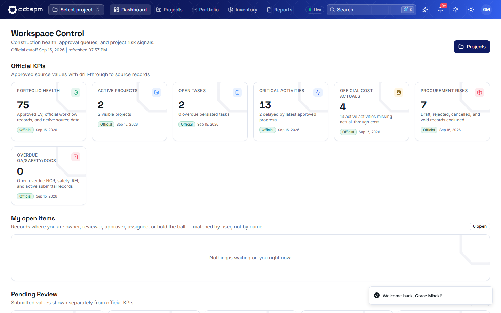
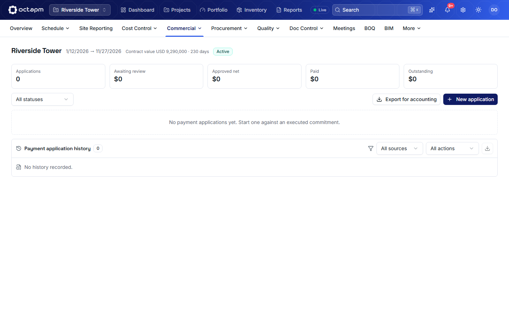
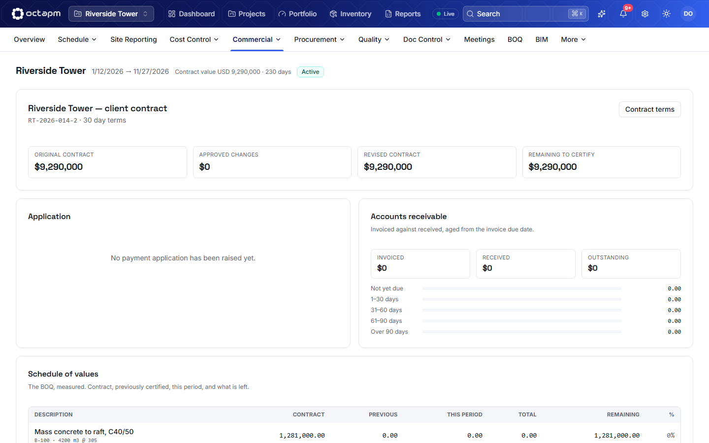

# Finance

Validated in the browser on 15 September 2026 as Grace Mbeki (Finance).

## A. Role overview

You move the money: pay certified subcontractor applications and approved direct costs, certify
client periods and issue client invoices, record client receipts and advances, release retention,
match supplier invoices to orders and deliveries, lock reporting periods, and read cash flow.
Costs are posted when the QS and PM certify; your payments change cash, not cost.

## B. Your typical day

Workspace Control → My open items (applications certified and awaiting payment, direct costs to
approve or pay). Then Project → Commercial → Pay Applications ("Awaiting finance — payment"),
Client Billing and IPC, Cash Flow; Inventory → Match for invoices.

## C. Your workspace

Needs You: certified pay applications, direct costs to approve or pay, IPC periods to certify,
tasks. Quick actions: none for this role; start from the module bar. KPIs: official cost
actuals, pending review.

## D. Modules you can access

| Module | Access |
| --- | --- |
| Commercial → Pay Applications | ACTION ACCESS: pay, accounting export and sync; review and certification are the QS's and PM's |
| Commercial → Client Billing, IPC, Contract, Cash Flow | ACTION ACCESS: certify periods, issue invoices, record payments and advances, release retention |
| Commercial → Commitments | ACTION ACCESS: execute and close commitments |
| Cost Control (Overview, Budget, Direct Costs) | ACTION ACCESS: approve, pay and void direct costs; lock reporting periods |
| Commercial → Change Orders, Change Events, Bids, EOT | VIEW |
| Procurement | VIEW |
| Inventory (Match, Items, Dashboard, Ledger) | READ ONLY (match view) |
| Schedule, Site Reporting, BOQ | READ ONLY / VIEW |
| Quality, Doc Control, Meetings, Tasks | VIEW |
| Reports | ACTION ACCESS: schedule and share |
| People, Company workspace | NOT AVAILABLE |

## E. Features available to you

Pay application detail with certified gross, retention, net, paid and outstanding; **Pay** with
amount, date and reference; accounting export; client billing statement (contract, previous,
this period, remaining), receivables ageing from the due date, advance recovery; IPC period
certify, invoice issue, payment record, retention release; cash flow (cash in, cash out,
retention held); direct cost approve, pay, void; reporting period lock; commitment execute and
close.

## F. Your core workflows

**Pay a certified application**
1. Workspace → My open items → the application (or Commercial → Pay Applications, status
   Approved, "Awaiting finance — payment").
2. Open it; check net after retention and deductions; **Pay** → amount, date, reference →
   confirm.
3. What happens next: Cash Out rises; the application reads Paid; Actual Cost does not change
   (it was posted at certification); the accounting export is available.

**Certify a client period and issue the invoice**
1. Commercial → IPC → the submitted period → **Certify**.
2. **Issue invoice**; Client Billing shows the certificate: gross less retention, advance
   recovery and deductions, then tax; receivables age from the due date.
3. When the client pays: **Record payment** (and any advance); Cash In rises; the advance is
   recovered at the contract rate.

**Approve and pay a direct cost**
1. Cost Control → Direct Costs → the submitted cost → **Approve** (Actual Cost posts) → later
   **Pay** (Cash Out).

**Match a supplier invoice**
1. Inventory → Match: the order, its deliveries and the invoice side by side; the verdict
   (matched, check, review) says whether quantities and prices agree.

**Lock a reporting period**
1. Cost Control → the period control → **Lock**; the PM may override.

## G. Your approvals

Direct costs (approve, pay, void); IPC periods (certify); invoices (issue); client payments and
advances (record); retention (release); commitments (execute, close); pay applications (pay,
accounting sync); reporting periods (lock). You do not certify pay applications (PM) or approve
change orders.

## H. Handoffs

Certified pay application → you (pay) → accounting export; submitted IPC period → you (certify,
invoice) → client → you (receipt); approved direct cost → you (pay); matched invoice → payment.

## I. Reports you use

Commercial → Cash Flow and Client Billing (receivables ageing); Pay Applications KPIs
(applications, awaiting review, approved net, paid, outstanding, retention held); Cost Control →
Overview; Inventory → Match; Reports.

## J. Common mistakes

- Paying before the PM certified; the product refuses, the row says who holds it.
- Recording a client receipt against the wrong period; the ageing then misleads.
- Expecting Actual Cost to move on payment; it moved at certification.

## K. Troubleshooting

- **Pay is missing on an application.** It is not Approved yet (QS review, PM certification).
- **Company directory is refused.** Administration; your role does not read it.
- **Cash Out does not match my ledger.** Compare with the accounting export on the application.

## L. Quick reference

| I want to | Go to |
| --- | --- |
| Pay a subcontractor | Commercial → Pay Applications |
| Certify a client period | Commercial → IPC |
| Issue an invoice, record a receipt | Commercial → IPC / Client Billing |
| Pay a direct cost | Cost Control → Direct Costs |
| Match an invoice | Inventory → Match |
| See cash flow | Commercial → Cash Flow |

## M. Daily checklist

- [ ] Review Needs You (payments, certifications).
- [ ] Pay Applications awaiting payment.
- [ ] IPC periods submitted.
- [ ] Client receipts to record; receivables overdue.
- [ ] Direct costs to approve or pay.
- [ ] Invoices to match.

## Your first 15 minutes

1. Sign in. 2. Read Needs You. 3. Select your project. 4. Commercial → Pay Applications.
5. Commercial → Client Billing. 6. Commercial → IPC. 7. Commercial → Cash Flow. 8. Cost Control →
Direct Costs. 9. Inventory → Match. 10. Reports.
