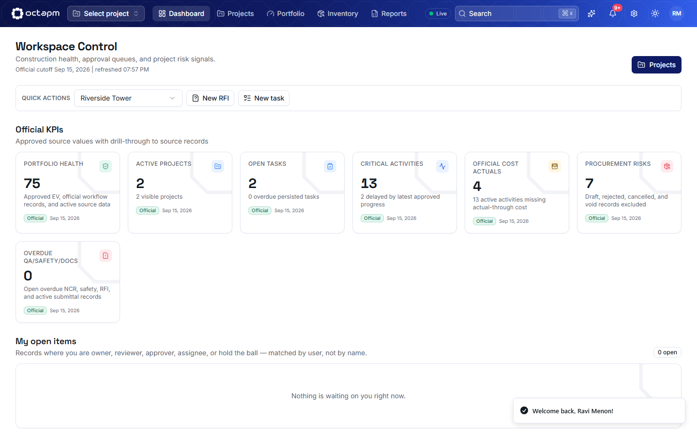

# Planner (Planning Engineer)

Validated in the browser on 15 September 2026 as Ravi Menon (Planning Engineer).

## A. Role overview

You own the schedule: activities, logic, dates, the baseline, progress and the lookahead. You
approve site progress submissions, publish the lookahead and drawings, keep the material plan and
long-lead dates, and see cost and commercial figures to understand their effect on the programme.

## B. Your typical day

Workspace Control → My open items (progress submissions to approve, tasks). Then Schedule →
Gantt for the critical path, Progress for what the site reported, Lookahead for the coming weeks,
Long Lead for what must be ordered.

## C. Your workspace

Needs You: progress submissions and daily logs waiting on you, tasks assigned to you. Quick
actions: **New RFI**, **New task**. KPIs: critical activities and "delayed by latest approved
progress" are yours to watch.

## D. Modules you can access

| Module | Access |
| --- | --- |
| Schedule (Gantt, Progress, Lookahead, Earned Value, Forecast, Resources, Risks, Long Lead, Revisions, WBS) | ACTION ACCESS: create and edit activities and logic, submit revisions for review, publish the lookahead; baseline lock and revision approval are the PM's |
| Site Reporting (Daily log, Timesheets, Activity, Site diary, Review) | ACTION ACCESS: update and submit logs, timesheets; approve progress submissions |
| BOQ | ACTION ACCESS: create and submit allocations; approval is the PM's or QS's |
| Cost Control | READ ONLY (overview, budget, direct costs) |
| Commercial | Change Orders READ ONLY; Change Events create and edit; Commitments and Bids view; Pay Applications, Client Billing, IPC NOT AVAILABLE |
| Procurement | ACTION ACCESS: packages and material plan; submit purchase orders |
| Inventory | READ ONLY |
| Quality (NCR, Inspections, Punch list, Observations, Safety, Material Tests) | ACTION ACCESS: raise NCRs, start and close inspections, punch items; approvals are the Quality Engineer's |
| Doc Control (RFI, Submittals, Drawings, …) | ACTION ACCESS: raise RFIs, submittals, upload revisions, publish drawings; closing RFIs and approving submittals are the PM's |
| Meetings, Tasks, Locations, Photos, BIM, Reports | ACTION ACCESS (distribute minutes, assign and close tasks, archive locations) |
| Team | ACTION ACCESS: assign parties and party members |
| People, Company workspace | NOT AVAILABLE |

## E. Features available to you

Gantt with critical path and float; activity edit; dependency logic; WBS; schedule revisions
submitted for the PM's review; baseline comparison on Revisions; progress submissions and their
approval; earned value (EV, SPI, CPI); forecast; resources; risks (submit); long-lead register
with order-by dates; lookahead publish; P6 / MS Project import; schedule export; daily logs and
site diary; RFIs; drawings publish; meetings distribution; tasks.

## F. Your core workflows

**Approve site progress**
1. Workspace → My open items → the submission (or Project → Schedule → Progress).
2. Compare the reported percent with the activity and the daily log. **Approve** or **Reject**
   with a reason.
3. What happens next: earned value, SPI, CPI, activity status and the critical path update; the
   workspace KPIs move; the site engineer sees the decision.

**Update the schedule and submit a revision**
1. Project → Schedule → Gantt → **Update Schedule**; edit dates, durations, logic.
2. Schedule → Revisions → submit the revision for review; the PM approves, activates or rolls
   back; the PM locks the baseline.

**Publish the lookahead**
1. Project → Schedule → Lookahead → set item status → **Publish**.
2. The site sees the coming weeks; distributed daily logs reference it.

**Keep the long-lead and material plan**
1. Project → Schedule → Long Lead: each material's need date and order-by date; late-to-order
   items show as procurement risks on the workspace.
2. Procurement → Packages: a package is created from a material requirement; you may submit its
   purchase order for the PM's approval.

**Raise an RFI from the programme**
1. Quick actions → **New RFI** → subject, question, activity → Open RFI.
2. The assignee receives it; the PM closes it after the answer.

## G. Your approvals

Progress submissions (approve, reject); lookahead publish; drawing publish; meeting distribution;
inspection close and reopen; NCR close (submit closeout); task close; party assignment; location
archive. You do not approve change orders, purchase orders, commitments, pay applications,
baselines or submittals.

## H. Handoffs

Approved progress → PM and cost control (earned value); a revision → the PM; a published lookahead
→ site engineers; a long-lead alert → procurement; an NCR you raise → the responsible person;
distributed minutes → task owners.

## I. Reports you use

Schedule → Earned Value and Forecast; Gantt critical path; Site Reporting → Review; Reports
(weekly progress report, EV report); workspace "Critical activities".

## J. Common mistakes

- Approving progress without the daily log to back it; the official EV moves at once.
- Editing dates on the live schedule without a revision, losing the baseline comparison.
- Leaving long-lead order-by dates blank; nothing then warns procurement.

## K. Troubleshooting

- **Pay Applications or IPC open on a different tab.** Your role cannot read them; Commercial
  lands on the first tab you may open.
- **I cannot lock the baseline.** Baseline lock is the PM's; submit the revision for review.
- **The schedule looks empty.** The project has no activities yet: import a P6 or MS Project
  file, or generate one from the BOQ, on Overview → setup readiness.

## L. Quick reference

| I want to | Go to |
| --- | --- |
| Approve progress | Workspace → My open items, or Schedule → Progress |
| Edit the programme | Schedule → Gantt → Update Schedule |
| Submit a revision | Schedule → Revisions |
| Publish the lookahead | Schedule → Lookahead |
| See what must be ordered | Schedule → Long Lead |
| Raise an RFI | Quick actions → New RFI |

## M. Daily checklist

- [ ] Review Needs You (progress submissions, tasks).
- [ ] Approve or reject yesterday's progress.
- [ ] Read the critical path and delayed activities.
- [ ] Check the lookahead against site reality.
- [ ] Check long-lead order-by dates and procurement risks.
- [ ] Raise RFIs on programme questions.

## Your first 15 minutes

1. Sign in. 2. Read Needs You. 3. Select your project. 4. Schedule → Gantt: critical path.
5. Schedule → Progress: what the site reported. 6. Schedule → Lookahead. 7. Schedule → Long Lead.
8. Site Reporting → Review. 9. Doc Control → RFI (open questions). 10. Tasks assigned to you.
