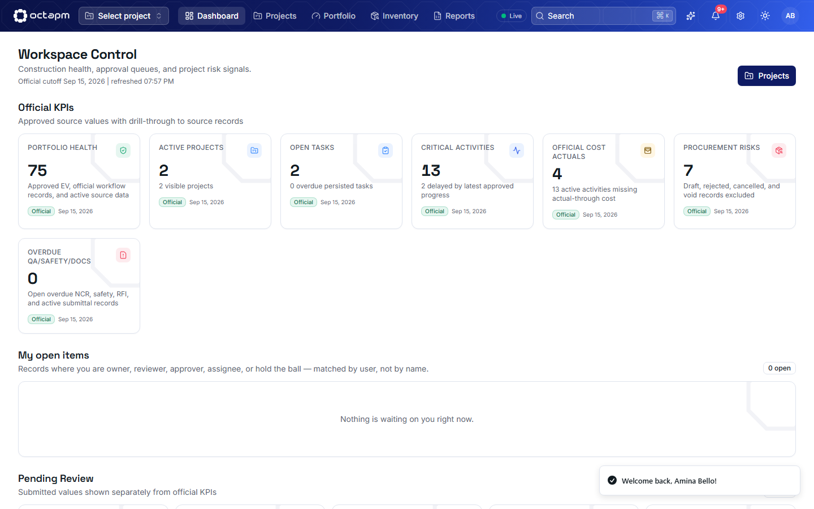
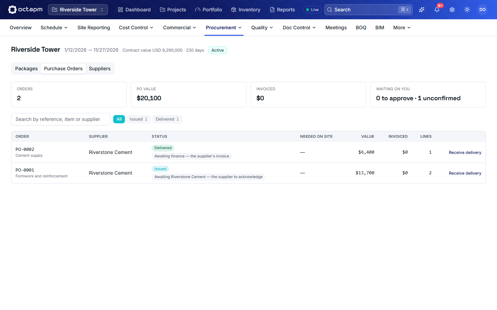
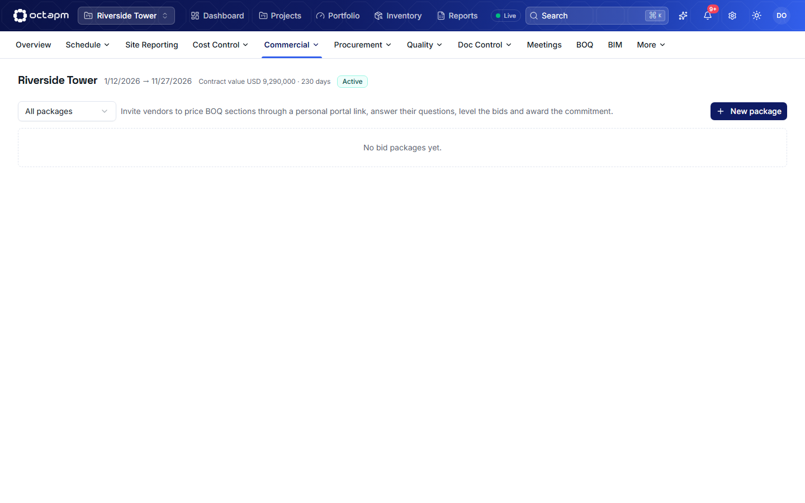

# Procurement

Validated in the browser on 15 September 2026 as Amina Bello (Procurement).

## A. Role overview

You buy what the project needs, in time: packages from the material plan, purchase orders through
approval, issue and acknowledgement, suppliers and their prequalification, bid packages published
to bidders, and the three-way match of order, delivery and invoice. Late-to-order packages are
your risk list.

## B. Your typical day

Workspace Control → Procurement risks, My open items (orders waiting on you, NCRs assigned to
you). Then Project → Procurement → Purchase Orders ("Waiting on you") and Packages (late to
order), and Commercial → Bids for open packages and bidder questions.

## C. Your workspace

Needs You: orders to send for approval or issue, unacknowledged orders, NCRs assigned to you,
tasks. Quick actions: none for this role (the four quick actions are records other roles raise);
start from the module bar. KPIs: procurement risks.

## D. Modules you can access

| Module | Access |
| --- | --- |
| Procurement (Packages, Purchase Orders, Suppliers) | ACTION ACCESS: packages and material plan, supplier management, orders (submit, issue, acknowledge, cancel, close), receipts; approval is the PM's |
| Inventory | ACTION ACCESS: items, goods receipts (stock receive) |
| Commercial → Bids | ACTION ACCESS: create packages, lines, invitations, publish, answer questions; award is the PM's |
| Commercial → Commitments | ACTION ACCESS: create, edit, submit purchase-order commitments; scope |
| Commercial → Change Events | VIEW; send RFQs to vendors |
| Commercial → Change Orders, Pay Applications (read), Client Billing, IPC, EOT | Change Orders NOT AVAILABLE; Pay Applications READ ONLY; Client Billing, IPC, EOT NOT AVAILABLE |
| Cost Control | NOT AVAILABLE |
| Schedule (Gantt, Long Lead) | READ ONLY; long-lead alerts acknowledge and resolve |
| Site Reporting | NOT AVAILABLE |
| BOQ | READ ONLY |
| Quality (NCR, Inspections, Punch, Safety) | VIEW; submit the closeout of an NCR assigned to you |
| Doc Control, Meetings, Tasks | VIEW |
| Reports | ACTION ACCESS: schedule and share |
| People, Company workspace | NOT AVAILABLE |

## E. Features available to you

Packages with needed-on-site and order-by dates and "days late to order"; purchase orders with
lines, supplier, status ("Awaiting the supplier — to acknowledge"), Receive delivery link, cancel
and close; the "Waiting on you" counts; supplier profiles and prequalification status; goods
receipts; three-way match; bid packages with lines, invitations (prequalification refusal and the
PM's override), publish, bidder questions and answers; leveling view; long-lead alerts.

## F. Your core workflows

**Raise and issue a purchase order**
1. Project → Procurement → Packages → the package (created from a material requirement on the
   schedule) → the order; or Purchase Orders for an order already drafted.
2. Supplier, lines, prices, needed-on-site date. **Submit** for approval.
3. The PM approves. **Issue** the order; when the supplier confirms, record the
   **acknowledgement**.
4. What happens next: PO value and Executed commitments update; the row says "Awaiting the
   supplier"; the storekeeper's **Receive delivery** link is ready.

**Run a bid package**
1. Project → Commercial → Bids → **New package** → title, description, instructions, due date,
   currency, subcontract or purchase order.
2. Add the bid form lines. Invite bidders from the directory (an unprequalified vendor is refused
   unless the PM records an override reason). **Publish**; each bidder receives a link.
3. Answer bidder questions on the package. On Leveling compare bids. The PM soft-awards and
   confirms; a commitment is raised from the winning lines.

**Keep suppliers**
1. Project → Procurement → Suppliers: the project's suppliers, their orders and status.
2. Company-level vendor profiles and prequalification are the administrator's (Company →
   Vendors); ask for a vendor to be prequalified before inviting it.

**Answer an NCR assigned to you**
1. Workspace → My open items → the NCR (or Project → Quality → NCR).
2. **Submit closeout**: photo or file evidence, closure comment, **Upload & submit**. The quality
   engineer approves.

## G. Your approvals

Bid publish; purchase order close (`po.close`); long-lead alert acknowledge and resolve; supplier
management. You do not approve purchase orders (PM), award bids (PM) or approve commitments (PM).

## H. Handoffs

Submitted purchase order → PM (approve) → you (issue) → supplier (acknowledge) → storekeeper
(receive) → Finance (invoice match). Published bid package → bidders (portal) → you (questions)
→ PM (award). Your NCR closeout → quality engineer.

## I. Reports you use

Purchase Orders KPIs (orders, PO value, invoiced, waiting on you); Packages' late-to-order
flags; Schedule → Long Lead; Inventory → Match and Dashboard; workspace "Procurement risks";
Reports.

## J. Common mistakes

- Issuing an order before the PM approved it; the product refuses, the row says who holds it.
- Inviting a bidder that is not prequalified without telling the PM; the invitation is refused.
- Leaving an acknowledged order open after the last delivery; close it so the match and the KPIs
  are clean.

## K. Troubleshooting

- **Commercial opens on Change Events, not Change Orders.** Your role cannot read change orders;
  Commercial lands on the first tab you may open.
- **No "New purchase order" button.** Orders come from packages; create the package from the
  material requirement on the schedule (Schedule → Long Lead) or open the package on Packages.
- **A bidder says the link expired.** Resend the invitation from the package; a new link is
  issued and the old one stops working.

## L. Quick reference

| I want to | Go to |
| --- | --- |
| See orders waiting on me | Project → Procurement → Purchase Orders |
| See what is late to order | Project → Procurement → Packages, Schedule → Long Lead |
| Run a tender | Project → Commercial → Bids |
| Receive a delivery myself | Workspace → Inventory → Goods in |
| Check order, delivery, invoice | Workspace → Inventory → Match |

## M. Daily checklist

- [ ] Review Needs You (orders, NCRs).
- [ ] Read Procurement risks on the workspace.
- [ ] Purchase Orders: send drafts for approval, issue approved ones, chase acknowledgements.
- [ ] Packages: late-to-order items.
- [ ] Bids: questions to answer, due dates near.
- [ ] Match: invoices against deliveries.

## Your first 15 minutes

1. Sign in. 2. Read Needs You and Procurement risks. 3. Select your project.
4. Procurement → Purchase Orders. 5. Procurement → Packages. 6. Procurement → Suppliers.
7. Commercial → Bids. 8. Schedule → Long Lead. 9. Inventory → Match. 10. Tasks assigned to you.
