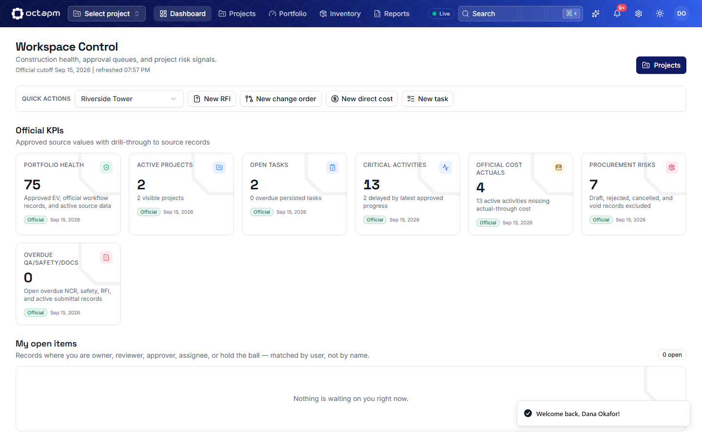
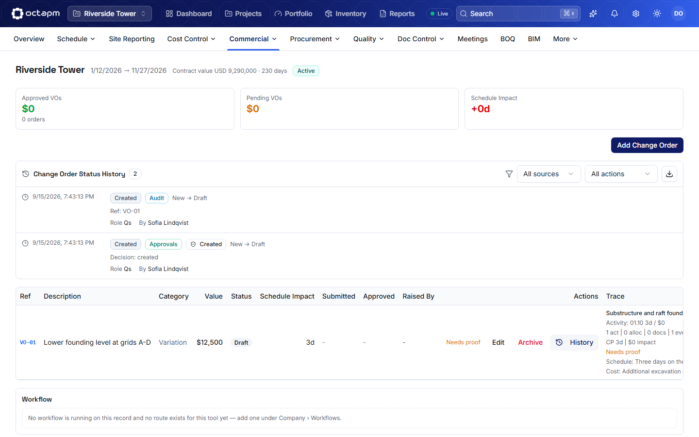

# Project Manager

Validated in the browser on 15 September 2026 as Dana Okafor (Project Manager, company
administrator) on the Riverside Tower demonstration project.

## A. Role overview

You run the project. In OctaPM you hold the widest view and the most decisions: you see every
module, approve change orders, purchase orders, commitments, pay applications and budget
allocations, close RFIs, approve progress and daily reports, and set the project's team and
permissions. As the company administrator you also keep the company's people, companies, cost
codes and templates.

## B. Your typical day

You start on Workspace Control: the Official KPIs tell you where the portfolio stands, My open
items tells you what waits on your decision, Pending review shows figures submitted but not yet
official. You clear approvals first (change orders, purchase orders, pay applications, progress),
then open the project to read health, schedule, cost and commercial, then the RFIs, NCRs and
tasks that need your input.

## C. Your workspace

- **Needs You (My open items):** change orders and purchase orders to approve, RFIs to close,
  progress and daily reports to approve, tasks assigned to you. Each item opens the record.
- **Quick actions:** New RFI, New change order, New direct cost, New task.
- **Official KPIs:** portfolio health, active projects, open tasks, critical activities, official
  cost actuals, procurement risks, overdue QA/safety/docs, each with a drill-through.
- **Pending review:** submitted values kept apart from the official figures until approved.
- **Queues:** workflow queues and the watchlist below the KPIs.

## D. Modules you can access

| Module | Access |
| --- | --- |
| Overview, Schedule (Gantt, Progress, Lookahead, Earned Value, Forecast, Resources, Risks, Long Lead, Revisions) | FULL ACCESS (approve revisions, lock baseline) |
| Site Reporting (Daily log, Timesheets, Activity, Site diary, Review) | FULL ACCESS (approve logs, diaries, reports, timesheets) |
| BOQ | FULL ACCESS (approve allocations) |
| Cost Control (Overview, By Activity, By Phase, Equipment, Burn Rate, Budget, Direct Costs) | FULL ACCESS (approve and pay direct costs, lock periods) |
| Commercial (Change Orders, Commitments, Pay Applications, Bids, Client Billing, IPC, Contract, Cash Flow, Change Events, Budget Revisions, EOT, Weather Delays) | FULL ACCESS (approve, award, certify, pay) |
| Procurement (Packages, Purchase Orders, Suppliers) | FULL ACCESS (approve, issue, close) |
| Inventory (Scan, Goods in, Match, Items, Warehouses, Dashboard, Ledger) | FULL ACCESS |
| Quality (NCR, Inspections, Punch list, Observations, Safety, Material Tests) | FULL ACCESS (approve closeouts, close punch items) |
| Doc Control (RFI, Submittals, Drawings, Specifications, Transmittals, Correspondence, Emails, Search) | FULL ACCESS (close RFIs, approve submittals and revisions) |
| Meetings, Tasks, Locations, Photos, Equipment, BIM, Reports | FULL ACCESS |
| Team, People, Company workspace (Directory, Vendors, Cost codes, Equipment, templates, Workflows, Custom fields, Integrations, Security, Permissions) | FULL ACCESS (company administrator) |

## E. Features available to you

Everything in the Role Feature Matrix; the approvals in section G; project creation and project
templates; permission templates per project; the team panel (add existing users, invite by email,
set a person's role on this project); report schedules and sharing; the assistant.

## F. Your core workflows

**Approve a change order**
1. Workspace → My open items → the change order (or Project → Commercial → Change Orders).
2. In the approval queue, check the value, the budget line named, the affected activities and the
   evidence documents.
3. **Approve** with a note, or **Disapprove** with a reason.
4. What happens next: Revised Budget and the named line update, Forecast follows, the QS sees the
   decision within a second, the audit history records you.

**Approve a purchase order**
1. Project → Procurement → Purchase Orders → the order "Awaiting the PM — approval".
2. Open it, check supplier, lines, prices and needed-on-site date. **Approve**.
3. Procurement issues it; the supplier acknowledges; the storekeeper receives it.

**Close an RFI**
1. Project → Doc Control → RFI → **Details** on the answered RFI.
2. Read the reply; **Close** with a decision note.
3. The raiser sees the closure at once; the answer stays on record for a change order to cite.

**Approve progress and daily reports**
1. Project → Schedule → Progress (submissions) and Site Reporting → Review.
2. Approve or reject; approved progress drives earned value and the dashboards.

**Certify a pay application**
1. Project → Commercial → Pay Applications → the submitted application.
2. Check the claim against the schedule of values, retention and deductions; **Approve**.
3. Certified cost posts to Actual Cost; Finance receives it for payment.

**Award a bid package**
1. Project → Commercial → Bids → the package → Leveling.
2. **Soft award** the recommended bid, then **Confirm award**; the commitment is raised from the
   priced lines and the bidder is told.

**Set up a project**
1. Workspace → Projects → new project (or from a project template under Company).
2. Overview → the setup readiness checklist walks you through activities, BOQ, budget, team.
3. Project → Team → **Add existing user** or invite by email; set each person's role here.

## G. Your approvals

Change orders (approve, reject, reopen); purchase orders (approve); commitments and commitment
change orders (approve, execute, close, void); pay applications (approve, void); direct costs
(approve, pay, void); budget allocations; progress submissions, daily logs, diaries and reports;
timesheets; RFIs (close, reopen); submittals and document revisions; bid awards; EOT claims; NCR
and safety closeouts (approve, reject, reopen); punch items (close, void); risks; IPC periods
(certify), invoices (issue); reporting periods (lock, override).

## H. Handoffs

- Approved change order → QS and cost control see it; Finance sees the revised contract on IPC.
- Approved purchase order → Procurement issues; supplier acknowledges; storekeeper receives.
- Certified pay application → Finance pays.
- Closed RFI → the raiser; a change order may follow.
- Approved progress → the planner's earned value and the workspace KPIs.

## I. Reports you use

Workspace Control KPIs and health dimensions; Project Overview; Cost Control → Overview (budget
block, Actual, Forecast, Variance); Schedule → Earned Value; Commercial → Cash Flow; Reports
(scheduled and shared reports); Quality dashboard KPIs.

## J. Common mistakes

- Approving a change order that names no budget line: the value parks on the holding line and
  the cost report shows it as unassigned. Ask the QS to name the line first.
- Approving a pay application before the certificate's retention and deductions are checked; the
  certified value posts to Actual Cost at once.
- Leaving progress submissions in Pending review; the official KPIs do not move until you approve.
- Adding a person to the project without setting their role here; they keep their company role.

## K. Troubleshooting

- **The Approve button is missing.** The record is not yet submitted, or it lacks proof ("Needs
  proof"). Ask the owner to complete it.
- **A figure looks wrong on Cost Overview.** Open the Budget tab: Original, Changes, Revised,
  Executed commitments, Actual and Forecast per line explain the total.
- **Somebody cannot see a module.** Project → Team → their role and permission template; the
  module bar hides what the role cannot read.
- **A page shows "Project access restricted".** The person is not a member of the project; add
  them on Team.

## L. Quick reference

| I want to | Go to |
| --- | --- |
| Approve anything | Workspace → My open items |
| See the budget | Project → Cost Control → Budget |
| Raise a change order | Quick actions → New change order |
| Award a package | Project → Commercial → Bids |
| Add a person to the project | Project → More → Team |
| Add a company | Company → Directory → Add company |
| Lock a baseline | Project → Schedule → Revisions |

## M. Daily checklist

- [ ] Read Official KPIs and Pending review.
- [ ] Clear My open items: change orders, purchase orders, pay applications, progress.
- [ ] Open the project: health, critical activities, forecast variance.
- [ ] Review open RFIs and NCRs waiting on the team.
- [ ] Check procurement risks (late-to-order packages).
- [ ] Review tasks and meeting actions due this week.

## Your first 15 minutes

1. Sign in. 2. Open Workspace Control. 3. Review Needs You. 4. Select your project. 5. Review
project health on Overview. 6. Review Schedule (Gantt, critical path). 7. Review Commercial
(change orders, commitments). 8. Review Cost Control (Overview, Forecast). 9. Review open RFIs and
NCRs. 10. Check the approvals waiting for you.
