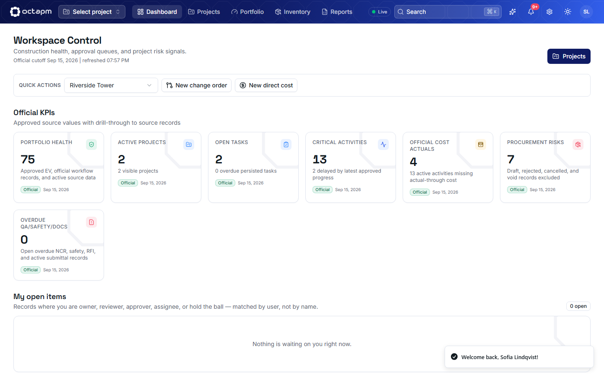
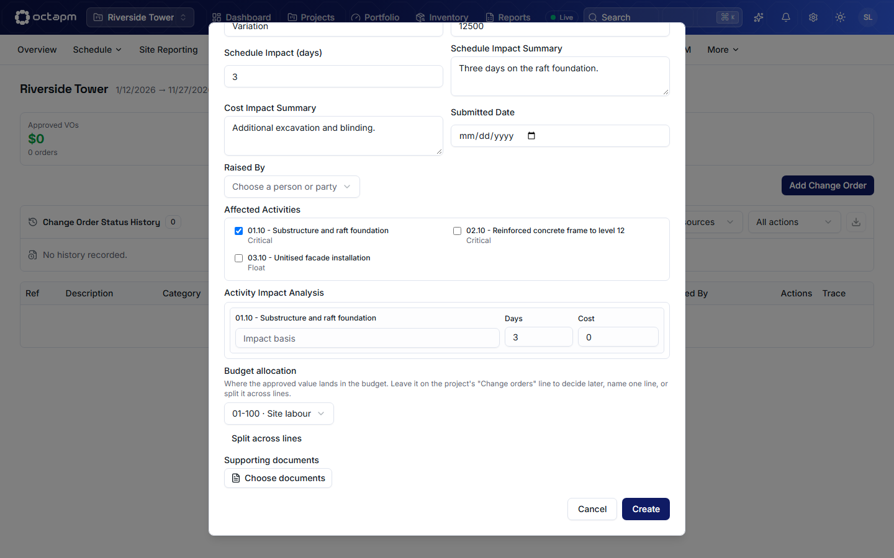

# QS / Commercial

Validated in the browser on 15 September 2026 as Sofia Lindqvist (QS).

## A. Role overview

You hold the money side of the contract: the bill of quantities and its allocation to the
programme, the budget lines, change orders (variations) and change events, subcontracts and
their pay applications, client valuations (IPC) and the prime contract terms, bids and
extensions of time. You raise and submit change orders with their proof; the PM approves them.

## B. Your typical day

Workspace Control → My open items: change orders sent back, pay applications to review, RFIs
that turned into a variation. Then Commercial → Change Orders, Pay Applications, and Cost
Control → Overview for the budget position.

## C. Your workspace

Needs You: pay applications to review, change orders disapproved back to you, allocations to
approve. Quick actions: **New change order**, **New direct cost**. KPIs: official cost actuals and
pending review.

## D. Modules you can access

| Module | Access |
| --- | --- |
| Commercial → Change Orders | ACTION ACCESS: create, edit, submit, reopen; approval is the PM's |
| Commercial → Change Events | FULL ACCESS: create, send RFQs to vendors, accept quotes, convert, close |
| Commercial → Commitments (subcontracts) | ACTION ACCESS: create, edit, submit, scope agree, closeout and evaluation approve; approval and execution are the PM's or Finance's |
| Commercial → Pay Applications | ACTION ACCESS: create, submit, review, reject; approval (certification) is the PM's; payment is Finance's |
| Commercial → Client Billing, IPC, Contract, Cash Flow | ACTION ACCESS: contract terms, periods, items, submit; certification, invoice and payments are Finance's or the PM's |
| Commercial → Bids | ACTION ACCESS: create packages, lines, invitations, answer questions; publish and award are the PM's (procurement may publish) |
| Commercial → EOT, Weather Delays, Budget Revisions | ACTION ACCESS: submit; approval is the PM's |
| Cost Control (Overview, Budget, Direct Costs, Burn Rate, By Activity) | ACTION ACCESS: budget lines, direct costs (submit), burn rate |
| BOQ | FULL ACCESS: items, allocations, approve allocations |
| Schedule, Site Reporting | VIEW; approve progress submissions |
| Procurement | VIEW (packages, purchase orders, suppliers) |
| Inventory | READ ONLY |
| Quality, Doc Control, Meetings, Tasks | VIEW; inspections start and sign; submittal review |
| Team | VIEW |
| People | VIEW (the policy lets the QS read People) |
| Company workspace | NOT AVAILABLE |

## E. Features available to you

Change-order form with category, value, schedule and cost impact summaries, affected activities,
budget line or split, and supporting documents picked from the register or from files already on
an RFI, submittal or NCR; the register's status, history and approval queue; commitments with
schedule of values, scope matrix, closeout checklist and evaluation; pay applications with
retention, deductions, materials on site and accounting export; IPC periods, adjustments, client
billing statement and receivables ageing; prime contract terms; bid packages, leveling, bidder
questions; budget lines and revisions; direct costs; burn rate.

## F. Your core workflows

**Raise and submit a change order**
1. Quick actions → **New change order** (or Project → Commercial → Change Orders → **Add Change
   Order**).
2. Description, category, value, schedule impact days and summary, cost impact summary; tick the
   affected activities; choose the **budget line** (or **Split across lines**; the default parks the
   value on the holding line); **Choose documents** → pick from the register or from **Attached to
   records** (the RFI's letter, for example). **Create**.
3. On the register, **Submit**. If the row says "Needs proof", add activities, evidence or the
   summaries first.
4. What happens next: the PM sees it in the approval queue within a second; on approval the
   Revised Budget and the named line update, Forecast follows, and you see "Approved".

**Review a pay application**
1. Project → Commercial → Pay Applications → **New application** on the subcontractor's behalf, or
   open a submitted one.
2. Check this period against previous and remaining on the schedule of values, retention,
   deductions, materials on site; **submit** or **reject** with a reason.
3. The PM approves (certifies); the certified value posts to Actual Cost; Finance pays.

**Run a client valuation**
1. Commercial → Contract → set retention, advance, materials-on-site and tax terms once.
2. Commercial → IPC → create the period, value the items, add adjustments, **submit**.
3. Finance or the PM certifies; the invoice is issued; Client Billing shows the statement.

**Allocate the bill to the programme**
1. Project → BOQ → items → allocate each to activities → submit; approve (QS or PM).
2. Cost Control → Budget → adopt cost codes → **Add line** per code and cost type.

**Run a bid package**
1. Commercial → Bids → **New package** → lines → invite bidders → the PM or procurement publishes.
2. Answer bidder questions; compare bids on Leveling; the PM awards.

## G. Your approvals

Allocations (approve, reject); pay applications (review, reject; submit on the subcontractor's
behalf); commitment closeout and evaluation (approve); change events (quote accept, convert,
close); progress submissions (approve); submittal review. You do not approve change orders, pay
applications (certification), commitments, bids, EOT or IPC certification.

## H. Handoffs

Submitted change order → PM; reviewed pay application → PM (certify) → Finance (pay); submitted
IPC period → Finance or PM (certify) → Finance (invoice, receipt); bid package → PM (award);
approved allocations → cost control.

## I. Reports you use

Cost Control → Overview (Original, Approved changes, Revised, Executed commitments, Actual,
Forecast, Variance) and Budget; Commercial → Cash Flow and Client Billing; the change-order
register's Approved VOs and pending totals; Reports.

## J. Common mistakes

- Submitting a change order with no budget line: it lands on the holding line and shows as
  unassigned on the cost report.
- Uploading a document that is already on the RFI instead of picking it from "Attached to
  records"; two copies of one letter.
- Certifying a pay application mentally before the PM has: the value posts only on the PM's
  approval.

## K. Troubleshooting

- **Submit is greyed and the row says "Needs proof".** Add affected activities, evidence and both
  impact summaries.
- **The split does not add up.** The split's amounts must equal the value to the cent.
- **The approved value is not on my line.** Open the register row's "Budget line:" text; a change
  approved with no line sits on "Change orders (decide later)".

## L. Quick reference

| I want to | Go to |
| --- | --- |
| Raise a variation | Quick actions → New change order |
| Review a pay application | Commercial → Pay Applications |
| Run a valuation | Commercial → IPC |
| Set contract terms | Commercial → Contract |
| Run a tender | Commercial → Bids |
| See the budget position | Cost Control → Overview |

## M. Daily checklist

- [ ] Review Needs You (pay applications, disapproved change orders).
- [ ] Submit pending change orders with proof.
- [ ] Review submitted pay applications.
- [ ] Check the budget position and forecast variance.
- [ ] Answer bidder questions on open packages.
- [ ] Check open RFIs for cost impact.

## Your first 15 minutes

1. Sign in. 2. Read Needs You. 3. Select your project. 4. Cost Control → Overview.
5. Commercial → Change Orders (drafts, pending, approved). 6. Commercial → Pay Applications.
7. Commercial → Commitments. 8. Commercial → IPC. 9. BOQ allocations. 10. Doc Control → RFI for
questions with cost impact.
