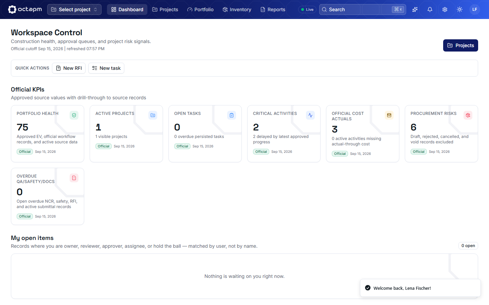
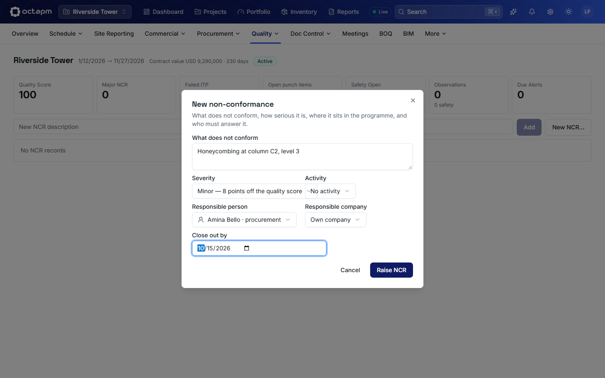
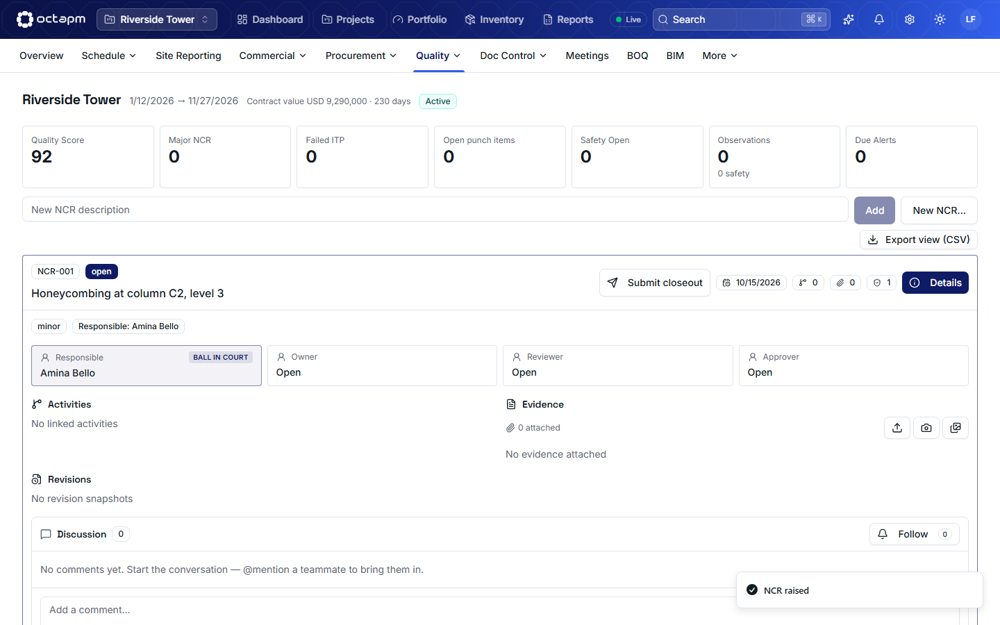
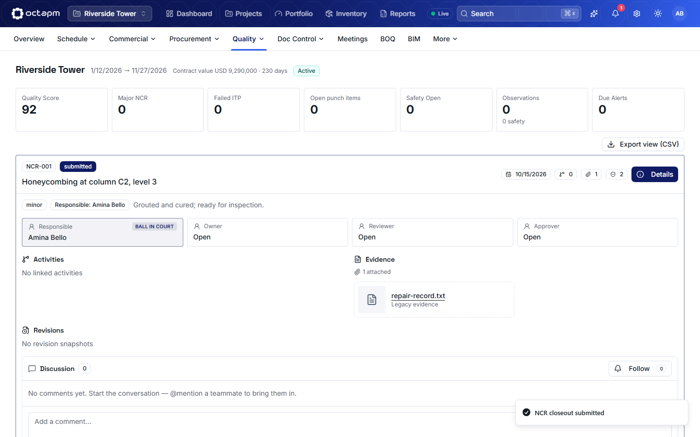
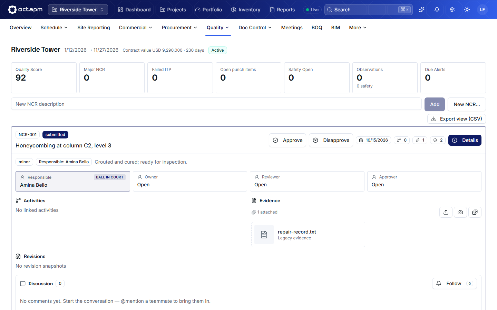
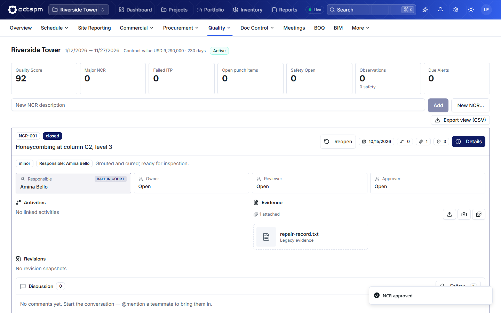

# Quality Engineer

Validated in the browser on 15 September 2026 as Lena Fischer (Quality Engineer).

## A. Role overview

You own quality and safety on the project: NCRs from raise to closeout approval, inspections and
test plans, punch lists, observations, safety incidents and material tests. You decide whether a
corrective action is good enough; the responsible person does the work.

## B. Your typical day

Workspace Control → My open items (closeouts submitted for your approval, inspections to close).
Then Project → Quality: the dashboard KPIs (Quality Score, Major NCR, Failed ITP, Open punch
items, Safety open, Observations, Due alerts) and each tab.

## C. Your workspace

Needs You: NCR and safety closeouts to approve, punch items ready for review, inspections,
tasks. Quick actions: **New RFI**, **New task**. KPIs: overdue QA/safety/docs.

## D. Modules you can access

| Module | Access |
| --- | --- |
| Quality → NCR | FULL ACCESS: raise, submit closeout, approve, reject, reopen |
| Quality → Safety | FULL ACCESS: record incidents, submit closeout, approve, reject, reopen |
| Quality → Inspections | FULL ACCESS: start, complete, sign, close, reopen, void; template admin |
| Quality → Punch list | FULL ACCESS: open, distribute, review, close, reopen, dispute, void |
| Quality → Observations, Material Tests | FULL ACCESS |
| Doc Control (RFI, Submittals, Drawings, …) | ACTION ACCESS: raise RFIs, submittals, revisions |
| Site Reporting, Schedule (progress, lookahead) | ACTION ACCESS: submit progress, logs, timesheets; publish lookahead |
| Inventory | ACTION ACCESS: issue and return stock |
| Commercial | Change Events: create; other tabs NOT AVAILABLE |
| Cost Control | NOT AVAILABLE |
| Procurement, BOQ | READ ONLY |
| Meetings, Tasks, Locations, Photos, Capture | ACTION ACCESS |
| People, Company workspace | NOT AVAILABLE (inspection templates are administered under Company by the administrator; you may administer templates through the inspection module) |

## E. Features available to you

Quality dashboard KPIs with live counts (void and archived records excluded); one dialog to
raise an NCR, a safety incident or a material test with severity or incident type, activity,
responsible person and company, due date; closeout dialog with photo or file evidence and a
closure comment; approve and reject with a note; inspections from templates with checks, sign
and close; punch list with company assignment, drawing pins, bulk entry, distribution, review
and close; observations; material tests with dates and results; export of registers.

## F. Your core workflows

**Raise an NCR**
1. Project → Quality → NCR → **New NCR…**.
2. Description, severity (minor or major), activity, responsible person (from the team),
   responsible company (from the project's parties), due date. **Raise**.
3. What happens next: the responsible person sees it in Needs You within a second, with
   **Submit closeout** on their Quality dashboard whatever their role; Quality Score falls for a
   major NCR.

**Approve or reject a closeout**
1. Workspace → My open items → the NCR (or Quality → NCR, status "submitted").
2. Read the evidence and the closure comment. **Approve** with a note, or **Reject** with the
   reason.
3. What happens next: approved → closed, leaves the responsible person's Needs You, Quality Score
   recovers; rejected → back with the responsible person.

**Run an inspection**
1. Quality → Inspections → start from a template (templates under Company → Inspection
   templates) → complete the checks → sign → **Close** (or reopen, void).
2. A failed inspection: raise an NCR naming it.

**Manage the punch list**
1. Quality → Punch list → **New item** (or bulk entry, or a pin on a drawing) → responsible
   company and person, priority, due date → **Distribute**.
2. When the company marks it ready for review, check it and **Close**; dispute or reopen if not.

**Record a safety incident**
1. Quality → Safety → **Record incident…** → incident type, severity, description, responsible
   person, due date. The closeout and approval follow the NCR pattern.

**Log a material test**
1. Quality → Material Tests → **Log test…** → test, date, activity, result.

## G. Your approvals

NCR closeouts (approve, reject, reopen); safety closeouts (approve, reject, reopen); inspections
(close, reopen, void); punch items (close, void). You do not approve progress, RFIs, submittals
or anything commercial.

## H. Handoffs

NCR you raise → responsible person → you (approve); punch item → responsible company → you
(close); failed inspection → NCR; safety incident → responsible person → you.

## I. Reports you use

Quality dashboard KPIs; NCR, punch, inspection and safety registers with export; Photos;
Reports (overdue punch items by trade, for example).

## J. Common mistakes

- Raising an NCR without a responsible person: nobody's Needs You shows it. Name the person.
- Closing an NCR yourself instead of letting the responsible person submit the corrective action;
  the evidence trail is theirs.
- Leaving a rejected closeout without a reason; the responsible person cannot act on it.

## K. Troubleshooting

- **The responsible person says they see no Submit closeout.** Check the NCR names them as the
  responsible person (assignee), not only their company.
- **Approve is missing.** The closeout is not submitted yet (status open).
- **Cost Control opens Overview instead.** Your role does not read cost; the module bar hides it.

## L. Quick reference

| I want to | Go to |
| --- | --- |
| Raise an NCR | Quality → NCR → New NCR… |
| Approve a closeout | Workspace → My open items |
| Run an inspection | Quality → Inspections |
| Manage punch items | Quality → Punch list |
| Record an incident | Quality → Safety → Record incident… |
| Log a test | Quality → Material Tests → Log test… |

## M. Daily checklist

- [ ] Review Needs You (closeouts, inspections, punch review).
- [ ] Quality dashboard KPIs: score, major NCRs, failed ITPs, overdue.
- [ ] NCRs due this week without a closeout.
- [ ] Inspections planned today.
- [ ] Punch items ready for review.
- [ ] Safety incidents open.

## Your first 15 minutes

1. Sign in. 2. Read Needs You. 3. Select your project. 4. Quality → NCR. 5. Quality →
Inspections. 6. Quality → Punch list. 7. Quality → Safety. 8. Quality → Material Tests.
9. Doc Control → RFI. 10. Tasks assigned to you.
