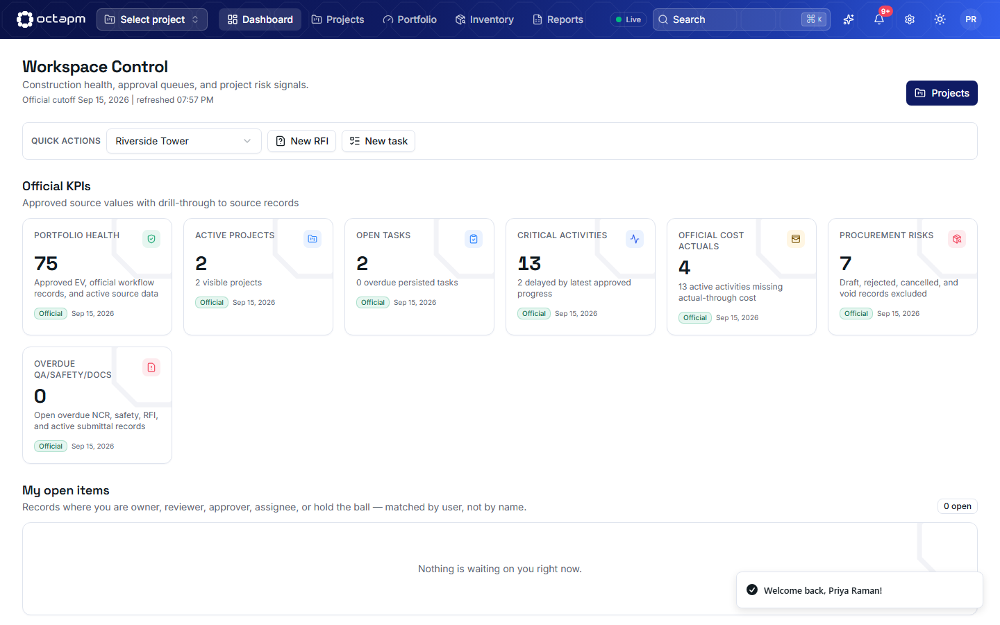
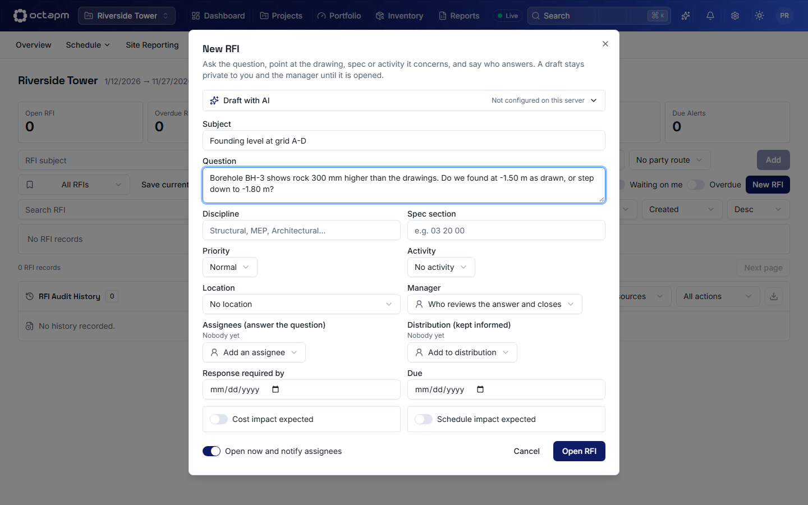
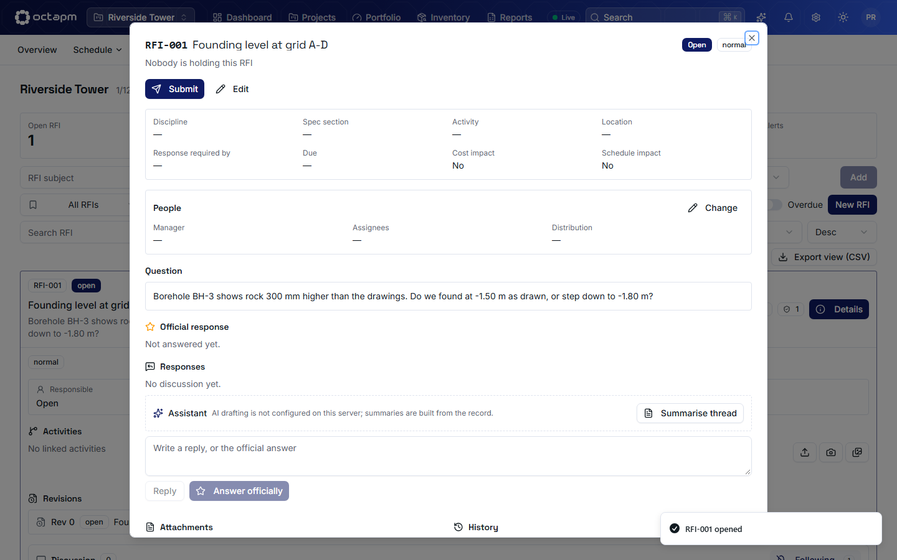

# Site Engineer

Validated in the browser on 15 September 2026 as Priya Raman (Site Engineer).

## A. Role overview

You are the project's eyes on site. You report progress and daily site information, raise RFIs
when the drawings do not answer a question, raise NCRs, punch items and observations, run
inspections, log timesheets, request and issue materials, and act on what is assigned to you.

## B. Your typical day

Workspace Control → My open items (RFIs answered, NCRs assigned, tasks). Then the project:
Schedule → Lookahead for today's activities, Doc Control → RFI, Site Reporting → Daily log,
Quality for anything assigned to you.

## C. Your workspace

Needs You: RFIs you raised that were answered, NCRs and punch items assigned to you, tasks.
Quick actions: **New RFI**, **New task**.

## D. Modules you can access

| Module | Access |
| --- | --- |
| Doc Control → RFI | ACTION ACCESS: raise, submit, answer; closing is the PM's |
| Doc Control → Submittals, Drawings, Specifications, Transmittals, Correspondence, Search | ACTION ACCESS: create submittals, resubmit, upload revisions and submit them for review |
| Site Reporting (Daily log, Timesheets, Activity, Diary, Review) | ACTION ACCESS: update and submit logs, diaries, reports and timesheets; distribute daily logs; worker admin |
| Schedule (Gantt, Progress, Lookahead, …) | ACTION ACCESS: submit progress; publish lookahead; item status |
| Quality (NCR, Inspections, Punch list, Observations, Safety, Material Tests) | ACTION ACCESS: raise NCRs and safety incidents, submit closeouts, start, complete and sign inspections, open and distribute punch items; approvals are the Quality Engineer's |
| Capture, Locations, Photos | ACTION ACCESS |
| Inventory | ACTION ACCESS: issue and return stock; material use |
| Commercial | Change Events: create; Change Orders, Commitments, Pay Applications, Bids, Client Billing NOT AVAILABLE |
| Cost Control | NOT AVAILABLE |
| Procurement | READ ONLY |
| BOQ | READ ONLY |
| Meetings, Tasks | ACTION ACCESS: assign and close tasks, comment |
| People, Company workspace | NOT AVAILABLE |

## E. Features available to you

New RFI form (subject, question, activity, party, priority, needed-by, attachments) and the
inline quick-add on the register; RFI details with reply; daily log with the day strip, manpower
report and photos; site diary; progress submissions; timesheets with crews and workers; the
Capture screen (punch item, observation, photos, inspection, daily report, drawings); NCR and
safety incident raise with responsible person, company and due date; closeout submission with
evidence; punch items with drawing pins and distribution; inspections from templates; material
issue and return; lookahead publish; tasks.

## F. Your core workflows

**Raise an RFI**
1. Quick actions → **New RFI** (or Project → Doc Control → RFI → **New RFI**; or type a subject
   in the register's quick-add box and **Add**).
2. Subject, question; optionally activity, party, priority, needed-by date; attach a drawing or
   photo. **Open RFI**.
3. What happens next: the assignee sees it within a second; when answered and closed you see the
   status change in your register and the item leaves your Needs You.

**Report progress**
1. Project → Schedule → Progress (or More → Capture → Daily report).
2. Percent complete per activity, notes, photos. **Submit**.
3. The planner or PM approves; earned value updates.

**Keep the daily log**
1. Project → Site Reporting → Daily log → pick the day on the strip → **Open**.
2. Manpower, weather, work done, issues, photos. Submit; the PM approves; **Distribute** sends it.

**Log a timesheet**
1. Site Reporting → Timesheets → **New timesheet** → crew → workers' hours against activities and
   cost codes → Save → **Submit**. The cost controller approves; labour cost posts.

**Raise an NCR or a punch item**
1. Project → Quality → NCR → **New NCR…** (or Punch list → **New item**, or Capture).
2. Description, severity, activity, responsible person and company, due date. Raise.
3. The responsible person receives it; the quality engineer approves the closeout.

**Answer an NCR assigned to you**
1. Workspace → My open items → the NCR → **Submit closeout** → evidence + comment → **Upload &
   submit**. The quality engineer approves or rejects.

**Issue material**
1. Workspace → Inventory → Items → **Issue** → store, quantity, activity → confirm. Actual Cost
   posts against the activity.

## G. Your approvals

None of the commercial or cost kind. You may close tasks you own, close an NCR you raised by
submitting its closeout, distribute daily logs and punch lists, publish the lookahead, sign
inspections. Approvals of progress, RFIs, NCR closeouts and timesheets belong to others.

## H. Handoffs

RFI → assignee → PM (close) → you; progress → planner or PM; daily log → PM; timesheet → cost
controller; NCR → responsible person → quality engineer; punch item → responsible company →
quality engineer or PM (close); material issue → cost control.

## I. Reports you use

Schedule → Lookahead and Gantt; Site Reporting → Review; Doc Control → RFI register (open,
overdue); Quality dashboard (open punch, NCRs); Photos.

## J. Common mistakes

- Raising an RFI without the activity or a drawing; the answer takes longer.
- Reporting progress in the daily log only; progress must be submitted on Schedule → Progress (or
  Capture) to move earned value.
- Issuing material to the wrong activity.

## K. Troubleshooting

- **Commercial opens on Change Events.** Your role reads no other Commercial tab.
- **I cannot close my RFI.** Closing is the PM's; your answer or acceptance is recorded in the
  reply.
- **My NCR closeout was rejected.** Read the reason on the NCR, redo the corrective action,
  submit again with new evidence.

## L. Quick reference

| I want to | Go to |
| --- | --- |
| Raise an RFI | Quick actions → New RFI |
| Report progress | Schedule → Progress, or More → Capture |
| Fill the daily log | Site Reporting → Daily log |
| Raise an NCR / punch item | Quality → NCR / Punch list, or Capture |
| Issue material | Inventory → Items → Issue |
| See today's work | Schedule → Lookahead |

## M. Daily checklist

- [ ] Review Needs You.
- [ ] Review today's activities (Lookahead).
- [ ] Review open RFIs.
- [ ] Record daily site information (log, photos, progress).
- [ ] Check material requirements and issues.
- [ ] Raise issues needing management input (RFI, observation).
- [ ] Review assigned quality actions (NCR, punch).

## Your first 15 minutes

1. Sign in. 2. Read Needs You. 3. Select your project. 4. Schedule → Lookahead. 5. Doc Control →
RFI. 6. Site Reporting → Daily log (today). 7. Quality → NCR and Punch list. 8. More → Capture.
9. Inventory → Items. 10. Tasks assigned to you.
