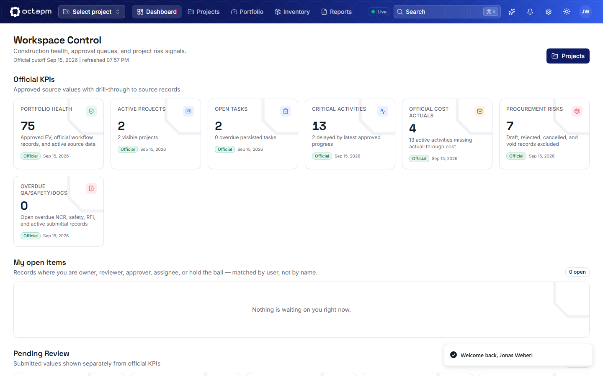
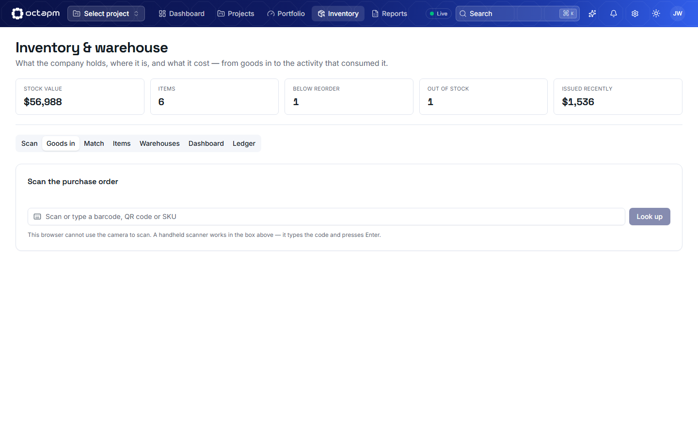
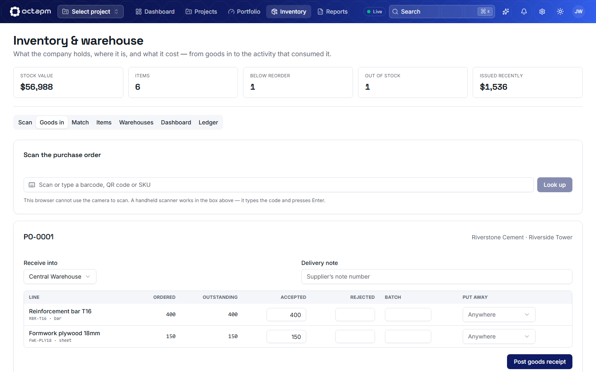
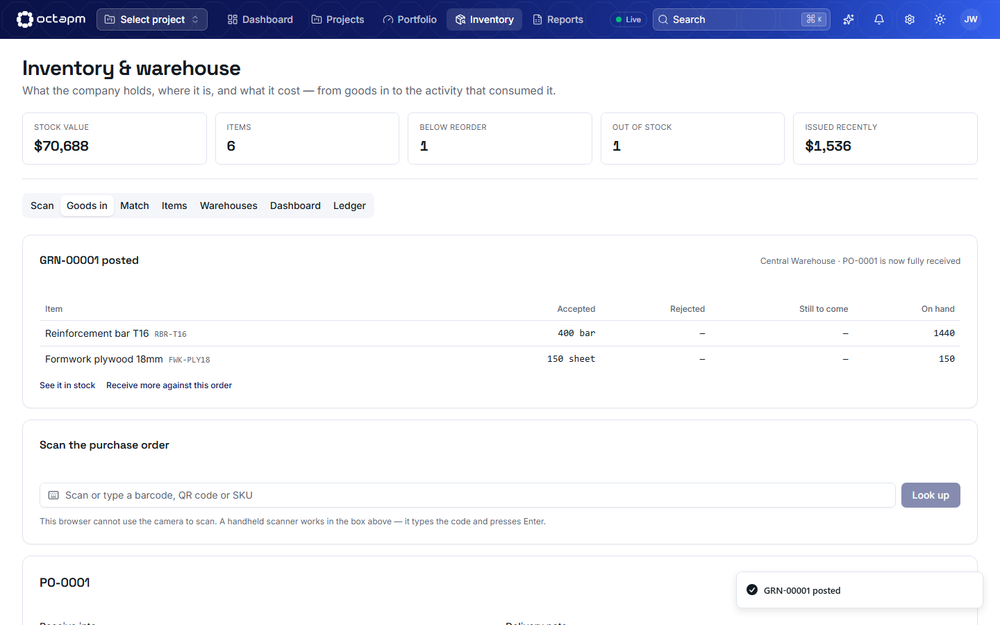

# Storekeeper / Warehouse

Validated in the browser on 15 September 2026 as Jonas Weber (Warehouse).

## A. Role overview

You run the stores: receive deliveries against purchase orders, keep stock on the shelf right,
issue materials to the activities that use them, move, count, return and adjust stock, and keep
the warehouses and bins. Every issue you post becomes actual cost on the project.

## B. Your typical day

Workspace Control → My open items. Then Workspace → Inventory: Goods in for deliveries, Items for
stock below reorder level and issues, Match for orders whose invoice is in, Dashboard for the
store's value.

## C. Your workspace

Needs You: deliveries to receive (orders issued and acknowledged), tasks. Quick actions: none for
this role; start from **Inventory** in the top bar. KPIs: procurement risks are visible; your own
figures are on Inventory → Dashboard.

## D. Modules you can access

| Module | Access |
| --- | --- |
| Inventory (Scan, Goods in, Match, Items, Warehouses, Dashboard, Ledger) | FULL ACCESS: receive, issue, return, transfer, adjust, count; items and warehouses |
| Procurement (Packages, Purchase Orders, Suppliers) | VIEW; post receipts; long-lead alerts acknowledge and resolve |
| Schedule (Gantt, activities) | READ ONLY |
| BOQ | READ ONLY |
| Quality, Doc Control, Meetings, Tasks | VIEW; comment on tasks and meetings |
| Cost Control, Commercial (Change Orders, Commitments, Pay Applications, Client Billing, Bids), Site Reporting, Portfolio | NOT AVAILABLE |
| People, Company workspace | NOT AVAILABLE |

## E. Features available to you

Barcode scan; goods receipt against an order (accepted and rejected quantities, store and bin,
GRN number); three-way match; items with on hand, available, reorder level, average cost and
value; inline **Issue** per item; warehouses and bins; dashboard (stock value, below reorder);
ledger of every movement; transfers, reservations, returns, damage and quarantine.

## F. Your core workflows

**Receive a delivery**
1. Workspace → Inventory → **Goods in** (or follow **Receive delivery** from the order on
   Procurement → Purchase Orders, which opens Goods in with the order already found).
2. Scan or type the order number → the order and its lines appear.
3. Enter accepted and rejected quantities per line; choose the store and bin. **Post**.
4. What happens next: a GRN number is issued; stock on hand and value rise; the order reads
   Partially delivered or Delivered and procurement's list follows within a second; the receipt
   is ready for the three-way match.

**Issue material to an activity**
1. Inventory → **Items** → **Issue** on the item's row.
2. Store, quantity, the activity it is for; confirm.
3. What happens next: stock falls; the issue posts to Actual Cost at the weighted average cost
   against the activity; the ledger shows the movement; cost control sees it.

**Return, transfer, adjust, count**
1. Inventory → Items or Warehouses → the action on the row or the store.
2. Returns reverse an issue's cost; transfers move stock between stores; adjustments and counts
   correct the shelf, with a reason.

**Keep items and stores**
1. Inventory → Items: add or edit an item (SKU, name, unit, category, reorder level).
2. Inventory → Warehouses: stores, zones, aisles, racks, shelves, bins.

## G. Your approvals

None. Posting a receipt, an issue, a return or an adjustment is your act and needs no approval;
it is recorded in the ledger with your name.

## H. Handoffs

Posted receipt → procurement (order Delivered) and Finance (invoice match); posted issue → cost
control (Actual Cost); reorder alerts → procurement (a package for the item).

## I. Reports you use

Inventory → Dashboard (stock value, below reorder level, movements); Ledger; Match; Items list;
Reports.

## J. Common mistakes

- Posting a receipt into the wrong store; the stock is there, not where the site expects it.
  Transfer it.
- Issuing to the wrong activity; the cost lands on that activity's line. Return and reissue.
- Receiving against a planned or draft order; the product refuses until the order is issued.

## K. Troubleshooting

- **"Order not found" on Goods in.** Check the reference; the order must be issued or
  acknowledged, not draft, planned or cancelled.
- **An item is missing on Items.** Add it (or a first delivery creates it from the order line).
- **A page says the module is not available.** Cost Control and Commercial are not part of your
  role; the module bar shows what is.

## L. Quick reference

| I want to | Go to |
| --- | --- |
| Receive a delivery | Inventory → Goods in |
| Issue material | Inventory → Items → Issue |
| See what is below reorder | Inventory → Items, Dashboard |
| Check order, delivery, invoice | Inventory → Match |
| See every movement | Inventory → Ledger |

## M. Daily checklist

- [ ] Review Needs You.
- [ ] Goods in: deliveries expected today.
- [ ] Items: issues requested by site; items below reorder level.
- [ ] Match: orders with invoices in.
- [ ] Dashboard: stock value and movements.
- [ ] Counts and adjustments outstanding.

## Your first 15 minutes

1. Sign in. 2. Read Needs You. 3. Inventory → Dashboard. 4. Inventory → Items. 5. Inventory →
Warehouses. 6. Inventory → Goods in (try a scan). 7. Inventory → Ledger. 8. Project →
Procurement → Purchase Orders (what is coming). 9. Tasks. 10. Sign out on a shared machine.
