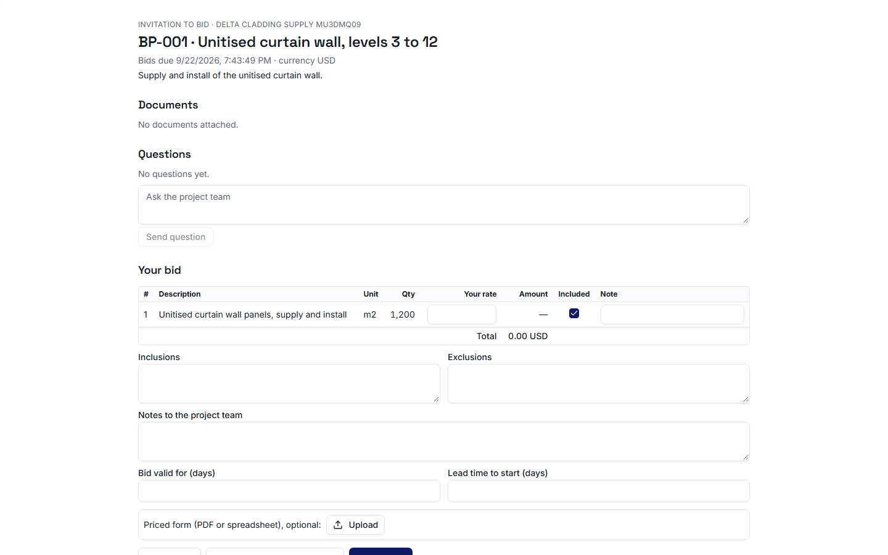
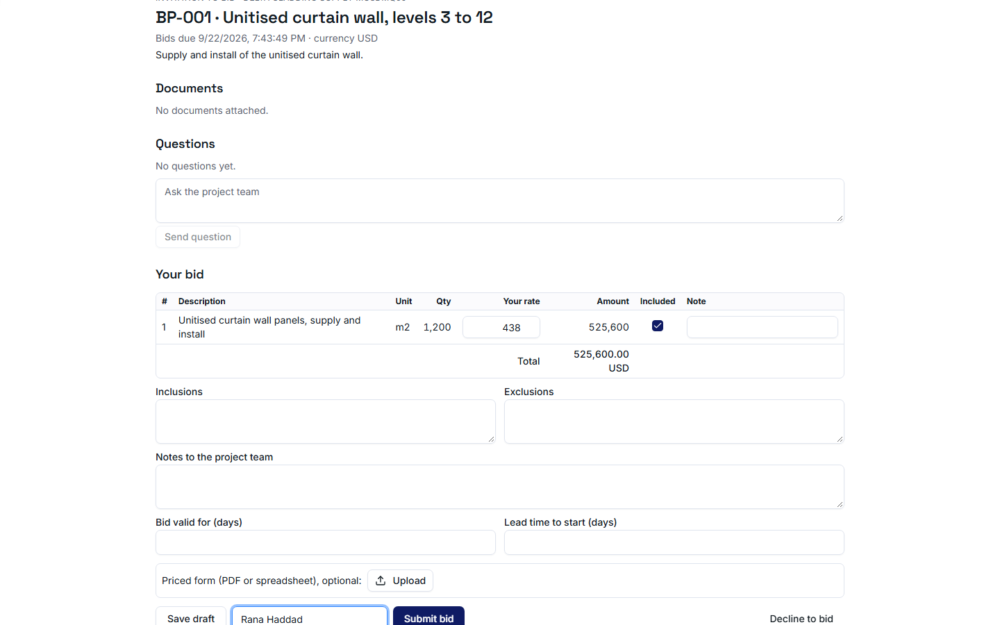
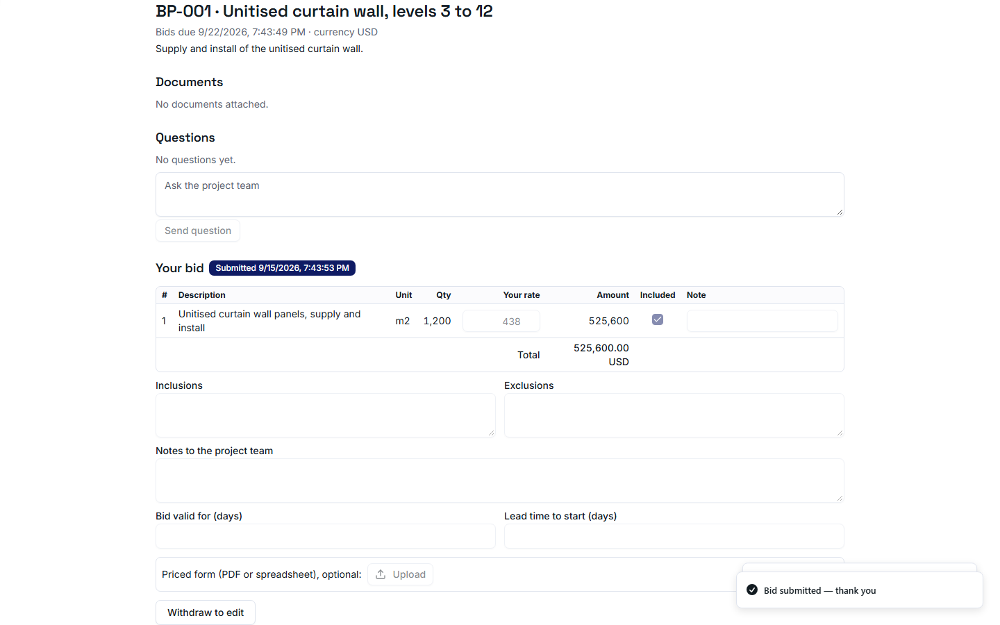

# Supplier / Bidder

Validated live on 15 September 2026 through the invitation link (no account), on the Riverside
Tower demonstration project.

## A. Role overview

You are a company invited to price a package. OctaPM sends you a link by email; the link opens
your own copy of the bid package, where you price the lines, ask questions, submit your bid, and
later learn the outcome. You do not sign in and you never see the contractor's workspace or the
other bidders.

## B. Your typical day

Open the invitation email, follow the link, read the package, price it before the due date.

## C. Your workspace

The bidder portal: the package title, description and instructions, the due date, the bid form
lines, the documents and addenda the buyer attached, your questions and the buyer's answers, and
your bid's status.

## D. Modules you can access

| What | Access |
| --- | --- |
| The package you were invited to | VIEW (title, instructions, due date, lines, documents, addenda) |
| Your bid | ACTION ACCESS: price lines or say why a line is excluded, add lead time and notes, upload a priced form, save a draft, sign and submit, withdraw to edit, resubmit before the due date |
| Questions to the project team | ACTION ACCESS: ask; read the answers |
| Award outcome | VIEW ("This package was awarded to you", or that the package closed) |
| Other bidders, their prices, the contractor's workspace | NOT AVAILABLE |

## E. Features available to you

Line pricing with the total worked out as you type; "Why excluded" for a line you do not price;
lead time; a priced form upload (PDF or spreadsheet); save draft; your name signs the bid;
withdraw and resubmit until the due date; questions and answers; documents and addenda; the
portal works at phone width.

## F. Your core workflows

**Price and submit**
1. Open the link from the invitation email. The package opens; no password is needed.
2. Enter a rate on each line (or tick it excluded and say why). Add lead time and notes; upload
   your priced form if you have one.
3. **Save draft** as often as you like. Type your name in **Your name (signs the bid)** and press
   **Submit**.
4. What happens next: the buyer sees your bid and its total on their leveling screen; your
   portal shows "Submitted" with the date and time.

**Change a submitted bid**
1. **Withdraw to edit** (the browser asks you to confirm). Edit the prices. Submit again. Only
   the latest submission counts; withdrawal is possible until the due date.

**Ask a question**
1. Type it under Questions and **Ask**. The buyer's answer appears on the same page (and may be
   issued to every bidder as an addendum).

## G. Your approvals

None. The buyer decides the award.

## H. Handoffs

Your submission → the buyer (leveling, award) → you (outcome on the portal).

## I. Reports you use

Your own bid's status and total on the portal.

## J. Common mistakes

- Submitting with an unpriced line and no exclusion reason; the portal refuses until every line
  is priced or excluded (or a priced form is uploaded).
- Editing after the due date; the package no longer accepts bids.
- Sharing the link; it is your company's private copy of the package.

## K. Troubleshooting

- **The link says it expired.** Ask the buyer to resend the invitation; a new link is issued.
- **The portal says the package is closed.** The due date passed or the buyer closed it.
- **I cannot see other bidders.** By design; each bidder sees only its own invitation.

## L. Quick reference

| I want to | Do |
| --- | --- |
| Price the package | open the link, enter rates, Save draft |
| Submit | your name, Submit |
| Change my bid | Withdraw to edit, resubmit |
| Ask something | Questions → Ask |

## M. Checklist before the due date

- [ ] Every line priced or excluded with a reason.
- [ ] Lead time and notes entered.
- [ ] Priced form uploaded (optional).
- [ ] Questions asked and answers read.
- [ ] Bid submitted and "Submitted" shown.

## Your first 15 minutes

1. Open the invitation link. 2. Read the instructions and due date. 3. Open the documents.
4. Price the first line and watch the total. 5. Save a draft. 6. Ask a question if anything is
unclear. 7. Return before the due date to submit.
